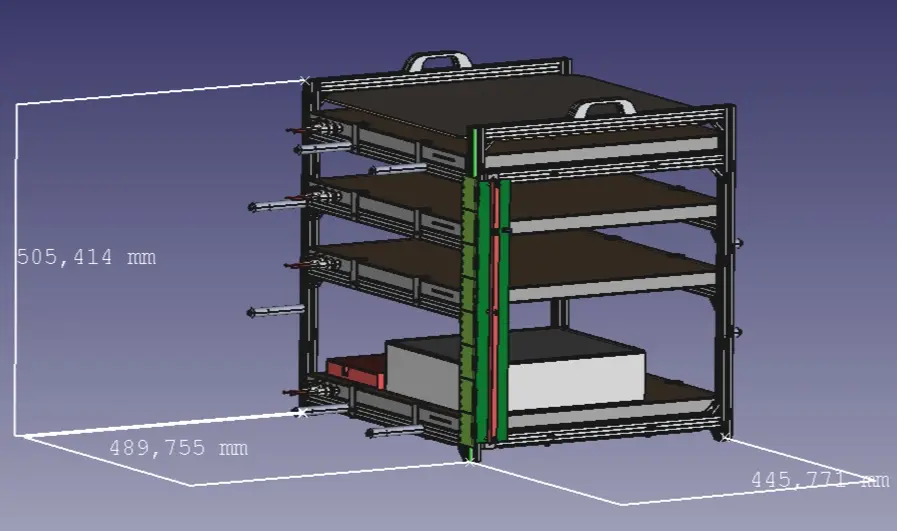
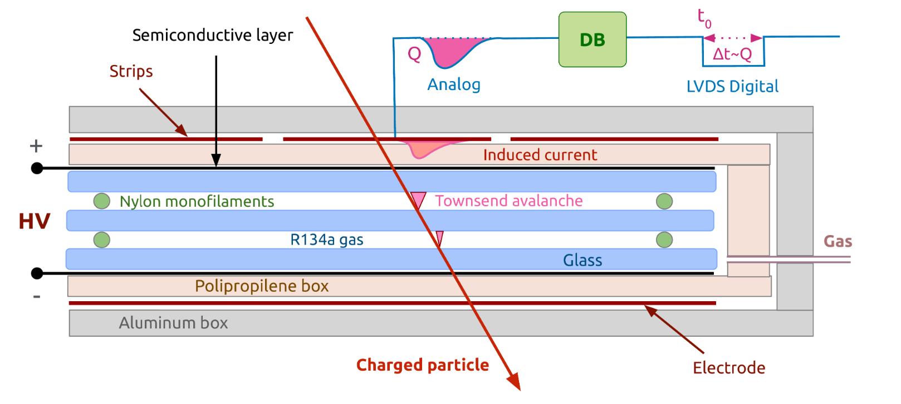
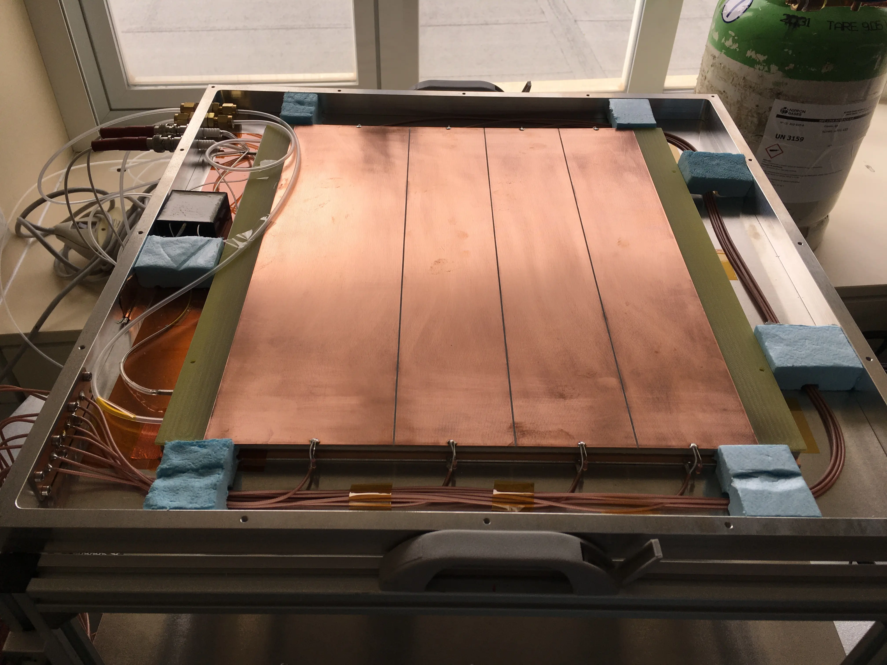
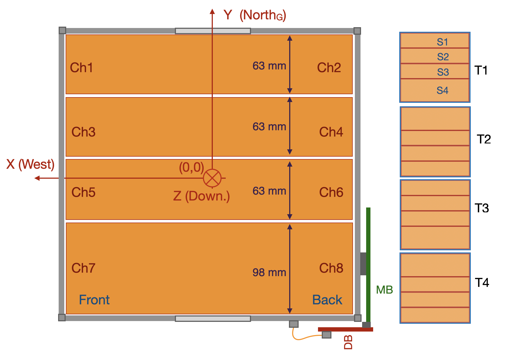

# Documentation photo archive and missing-image inventory

The recovered source collection from `/home/mingo/PHOTOS_FOR_DOCUMENTATION` is now stored under `assets/photos/PHOTOS_FOR_DOCUMENTATION/USED_IN_DOCUMENTATION/`. Original JPEGs and their WebP versions are retained there; byte-identical source assets already used by the Hardware page remain at their existing canonical paths as well.

## Recovered documentation images

## Images still missing from the documentation

This checklist was collected on 2026-10-29. It includes image references that were absent from their notebook locations at that time. The six images already added to the Hardware page are intentionally omitted. Add recovered originals or suitable replacements here, using the suggested filename where possible.

## Photos

| Suggested filename | Image needed | Documentation entry |
| --- | --- | --- |
| `old_calibrated_hole.png` | Close-up of the old, dusty gas inlet/calibrated-hole piece that had lower flow. | `DOCUMENTATION/docs/NOTEBOOKS/2026/07_JULY/2026_07_27_entry_3_notebook.md` |
| `new_calibrated_hole.png` | Close-up of the cleaner replacement calibrated-hole piece and its opening. | Same entry as above |
| `beautiful_new_calibrated_hole.jpeg` | Alternate/artistic photo of the new calibrated-hole piece. | Same entry as above |
| `spark.png` | Spark damage or the TOMAR RPC-cage HV feedthrough / grounding-plane area. | `DOCUMENTATION/docs/NOTEBOOKS/2026/07_JULY/2026_07_29_entry_1_notebook.md` |

## Plots, screenshots, and technical drawings

| Suggested filename | Visual needed | Documentation entry |
| --- | --- | --- |
| `2026_03_05_step2_1_3_random_showcase_distance_matrix.png` | STEP 2.1.3 random-showcase pairwise distance matrix. | `DOCUMENTATION/docs/NOTEBOOKS/2026/03_MARCH/2026_03_05_notebook.md` |
| `2026_03_17_streamer_to_streamer_matrix_columns.png` | MINGO01 vs MINGO00 streamer-to-streamer matrix-column comparison. | `DOCUMENTATION/docs/NOTEBOOKS/2026/03_MARCH/2026_03_17_notebook.md` |
| `mingo01_task3_2024.09.29_00.07.37_last_page.png` | Last page of the named MINGO01 Task 3 PDF. | `DOCUMENTATION/docs/NOTEBOOKS/2026/03_MARCH/2026_03_20_notebook.md` |
| `mingo00_task3_2008.07.27_02.30.56_last_page.png` | Last page of the named MINGO00 simulation Task 3 PDF. | Same entry as above |
| `mingo01_task1_2024.09.27_18.07.34_last_page.png` | Last page of the named MINGO01 Task 1 PDF. | Same entry as above |
| `12_efficiency_quantile_zoom.png` | Efficiency quantile zoom after the new cuts. | Same entry as above |
| `13_frozen_population_efficiency.png` | Frozen-population efficiency after the new cuts. | Same entry as above |
| `hvscan_mingo01.png` | MINGO01 HV-scan summary. | `DOCUMENTATION/docs/NOTEBOOKS/2026/04_APRIL/2026_04_29_notebook.md` |
| `hvscan_mingo02.png` | MINGO02 HV-scan summary. | Same entry as above |
| `hvscan_mingo04.png` | MINGO04 HV-scan summary. | Same entry as above |
| `temp.png` | Temperature context for the efficiency-correction period. | `DOCUMENTATION/docs/NOTEBOOKS/2026/04_APRIL/2026_04_30_notebook.md` |
| `step3_01_rate_to_flux_calibration.png` | Simulated rate-to-flux calibration plot. | Same entry as above |
| `step3_02_real_flux_time_series.png` | Real-data flux time series. | `DOCUMENTATION/docs/NOTEBOOKS/2026/04_APRIL/2026_04_30_notebook.md` |
| `2026_05_04_step3_02_real_flux_time_series.png` | Same real-data flux time series; reuse the April image if it is recovered. | `DOCUMENTATION/docs/NOTEBOOKS/2026/05_MAY/2026_05_05_notebook.md` |
| `mingo04_hv.png` | MINGO04 high-voltage time series. | `DOCUMENTATION/docs/NOTEBOOKS/2026/04_APRIL/2026_04_30_notebook.md` |
| `temp_mingo04.png` | MINGO04 temperature time series. | Same entry as above |
| `gas_grafana.png` | Grafana capture showing the four gas outlet flows around the calibrated-hole replacement. | `DOCUMENTATION/docs/NOTEBOOKS/2026/07_JULY/2026_07_27_entry_3_notebook.md` |
| `mingo_dimensions_1.jpeg` | First miniTRASGO dimensions/geometry drawing. | `DOCUMENTATION/docs/NOTEBOOKS/2026/07_JULY/2026_07_28_entry_1_notebook.md` |
| `mingo_dimensions_2.jpeg` | Second miniTRASGO dimensions/geometry drawing. | Same entry as above |
| `mingo00_gate_32768_plane_xy_histograms.png` | MINGO00 gate-32768 plane-position histogram. | `DOCUMENTATION/docs/NOTEBOOKS/2026/07_JULY/2026_07_30_entry_1_notebook.md` |
| `mingo02_gate_32768_plane_xy_histograms.png` | MINGO02 gate-32768 plane-position histogram. | Same entry as above |
| `caen_power_supply_rise_up.png` | CAEN high-voltage supply rise-up plot. | `DOCUMENTATION/docs/NOTEBOOKS/2026/07_JULY/2026_07_30_entry_2_notebook.md` |

There are 26 missing image references in total. Where the original plot inputs are unavailable, the notebook notes describe the original source and possible regeneration path. For photos, a suitable replacement is fine if the historical original cannot be found.
