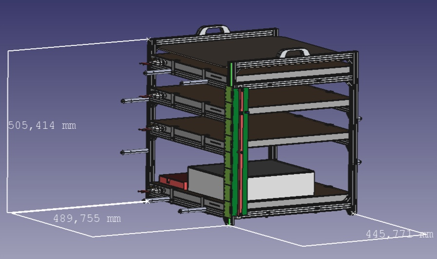
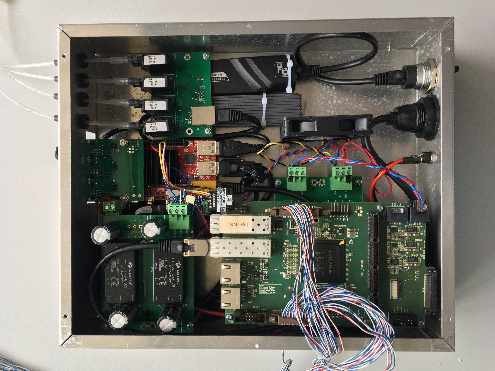

# Documentation photo archive and missing-image inventory

The recovered source collection from `/home/mingo/PHOTOS_FOR_DOCUMENTATION` is stored under `assets/photos/PHOTOS_FOR_DOCUMENTATION/USED_IN_DOCUMENTATION/`. Byte-identical copies were removed; pages use one canonical asset path.

## Recovered images kept as distinct originals

The telescope WebP, electronics-box WebP, readout-strip images, coordinate-frame diagram, RPC cross-section diagram, and electronics diagram matched canonical files elsewhere in `assets/`; the canonical copies are used in the [hardware documentation](hardware.md).

## Images still missing from the documentation

The recovered images that matched missing notebook figures have been moved to their month-local `FIGURES/` directories. Eight recovered files were byte-identical to files already in place and needed no action. For 49 same-name files with different SHA-256 hashes, both copies are kept beside the notebook figures: each recovered file is labeled **original**, and each previously present file is labeled **reconstructed**. The local comparison report is `DOCUMENTATION/RECOVERED/IMAGE_CONFLICTS.md`.

Three recovered image files were empty, so the corresponding figures remain unavailable:

| Missing filename | Image needed | Documentation entry |
| --- | --- | --- |
| `mingo00_task3_2008.07.27_02.30.56_last_page.png` | Last page of the named MINGO00 simulation Task 3 PDF. | `NOTEBOOKS/2026/03_MARCH/2026_03_20_notebook.md` |
| `new_calibrated_hole.png` | Photo of the replacement calibrated-hole piece. | `NOTEBOOKS/2026/07_JULY/2026_07_27_entry_3_notebook.md` |
| `spark.png` | Photo of the TOMAR RPC-cage HV feedthrough spark or damage. | `NOTEBOOKS/2026/07_JULY/2026_07_29_entry_1_notebook.md` |

A few recovered plot files have no matching image reference in the current or recovered Markdown, so they remain in `DOCUMENTATION/RECOVERED` until their intended use is clear.
