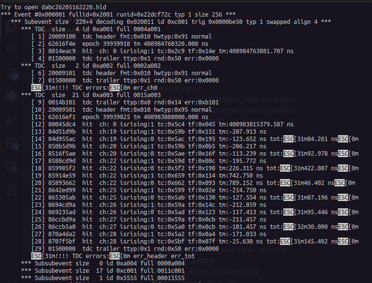

# Output of: 

```bash
rpcuser@tomar:~/hlds$ hldprint dabc26205162220.hld -sub -tdc 0xa003 -all | less
```

Will give the structure of the hlds.

```text
Try to open dabc26205162220.hld
*** Event #0x000001 fullid=0x2001 runid=0x22dcf72c typ 1 size 256 *** 
   *** Subevent size  220+4 decoding 0x020011 id 0xc001 trig 0x0000be50 typ 1 swapped align 4 ***
      *** TDC  size   4 id 0xa001 full 0004a001
         [ 1] 20009100  tdc header fmt:0x010 hwtyp:0x91 normal
         [ 2] 62616f4e  epoch 39939918 tm 408984760320.000 ns
         [ 3] 8014eac9  hit  ch: 0 isrising:1 tc:0x2c9 tf:0x14e tm:408984763881.707 ns
         [ 4] 01500000  tdc trailer ttyp:0x1 rnd:0x50 err:0x0000
      *** TDC  size   2 id 0xa002 full 0002a002
         [ 6] 20009101  tdc header fmt:0x010 hwtyp:0x91 normal
         [ 7] 01500000  tdc trailer ttyp:0x1 rnd:0x50 err:0x0000
         ESC[31m!!!! TDC errors:ESC[0m err_ch0
      *** TDC  size  21 id 0xa003 full 0015a003
         [ 9] 0014b101  tdc trailer ttyp:0x0 rnd:0x14 err:0xb101
         [10] 20009501  tdc header fmt:0x010 hwtyp:0x95 normal
         [11] 62616ef1  epoch 39939825 tm 408983808000.000 ns
         [12] 80045dc4  hit  ch: 0 isrising:1 tc:0x5c4 tf:0x045 tm:408983815379.587 ns
         [13] 84d51d9b  hit  ch:19 isrising:1 tc:0x59b tf:0x151 tm:-207.913 ns
         [14] 84d955ac  hit  ch:19 isrising:0 tc:0x5ac tf:0x195 tm:-123.652 ns tot:ESC[31m84.261 nsESC[0m
         [15] 850b5d9b  hit  ch:20 isrising:1 tc:0x59b tf:0x0b5 tm:-206.217 ns
         [16] 8516f5ae  hit  ch:20 isrising:0 tc:0x5ae tf:0x16f tm:-113.239 ns tot:ESC[31m92.978 nsESC[0m
         [17] 8588cd9d  hit  ch:22 isrising:1 tc:0x59d tf:0x08c tm:-195.772 ns
         [18] 859985f2  hit  ch:22 isrising:0 tc:0x5f2 tf:0x198 tm:226.315 ns tot:ESC[31m422.087 nsESC[0m
         [19] 85914e59  hit  ch:22 isrising:1 tc:0x659 tf:0x114 tm:742.750 ns
         [20] 85893662  hit  ch:22 isrising:0 tc:0x662 tf:0x093 tm:789.152 ns tot:ESC[31m46.402 nsESC[0m
         [21] 8642ed99  hit  ch:25 isrising:1 tc:0x599 tf:0x02e tm:-214.750 ns
         [22] 865305ab  hit  ch:25 isrising:0 tc:0x5ab tf:0x130 tm:-127.554 ns tot:ESC[31m87.196 nsESC[0m
         [23] 8694cd9a  hit  ch:26 isrising:1 tc:0x59a tf:0x14c tm:-212.859 ns
         [24] 869235ad  hit  ch:26 isrising:0 tc:0x5ad tf:0x123 tm:-117.413 ns tot:ESC[31m95.446 nsESC[0m
         [25] 86ccbd9a  hit  ch:27 isrising:1 tc:0x59a tf:0x0cb tm:-211.457 ns
         [26] 86ccb5a0  hit  ch:27 isrising:0 tc:0x5a0 tf:0x0cb tm:-181.457 ns tot:ESC[32m30.000 nsESC[0m
         [27] 870a4da2  hit  ch:28 isrising:1 tc:0x5a2 tf:0x0a4 tm:-171.033 ns
         [28] 8707f5bf  hit  ch:28 isrising:0 tc:0x5bf tf:0x07f tm:-25.630 ns tot:ESC[31m145.402 nsESC[0m
         [29] 01500000  tdc trailer ttyp:0x1 rnd:0x50 err:0x0000
         ESC[31m!!!! TDC errors:ESC[0m err_header err_tot
      *** Subsubevent size   0 id 0xa004 full 0000a004
      *** Subsubevent size  17 id 0xc001 full 0011c001
      *** Subsubevent size   1 id 0x5555 full 00015555
```

*Recovered screenshot showing an example HLD dump with nested subevents and TDC data.*



Note the basic unit of the event:

```text
Try to open ....hld
*** Event #0x000001 ...
   *** Subevent size  220+4 ...
      *** TDC  size   4 ...
         ...
      *** TDC  size   2 ...
         ...
      *** TDC  size  21 ...
         ...   
         [12] 80045dc4  hit  ch: 0 isrising:1 tc:0x5c4 tf:0x045 tm:408983815379.587 ns
         [13] 84d51d9b  hit  ch:19 isrising:1 tc:0x59b tf:0x151 tm:-207.913 ns
         [14] 84d955ac  hit  ch:19 isrising:0 tc:0x5ac tf:0x195 tm:-123.652 ns tot:ESC[31m84.261 nsESC[0m
         ...
         [29] 01500000  tdc trailer ttyp:0x1 rnd:0x50 err:0x0000
         ESC[31m!!!! TDC errors:ESC[0m err_header err_tot
      ...
      *** Subsubevent ...
```