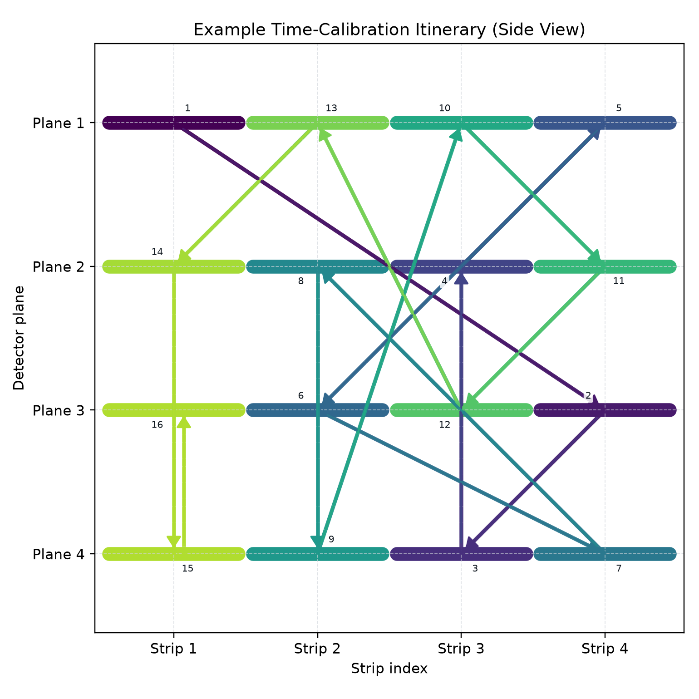

# 2026-03-05
## Plots added today
---

### STEP 2.1.3 random showcase distance matrix
This plot shows pairwise distance structure in a random showcase sample, useful to quickly inspect clustering and separation trends.

*Source recorded in this entry: `MINGO_DICTIONARY_CREATION_AND_TEST/STEPS/STEP_2_INFERENCE/STEP_2_1_ESTIMATE_PARAMS/OUTPUTS/PLOTS/2_1_3_random_showcase_distance_matrix.png`. Regenerate by rerunning STEP 2.1’s random-showcase distance-matrix plotting step with its original inference inputs/configuration, which are not archived here.*

Original source: `MINGO_DICTIONARY_CREATION_AND_TEST/STEPS/STEP_2_INFERENCE/STEP_2_1_ESTIMATE_PARAMS/OUTPUTS/PLOTS/2_1_3_random_showcase_distance_matrix.png`

### Time-calibration itinerary side view
This side-view itinerary plot summarizes the geometric path used in the STEP 1/TASK 2 time-calibration example.

*Regenerated with the existing time-calibration itinerary plotter from `itineraries.csv`, using a fixed seed to select a reproducible example. It shows the same path geometry; the selected itinerary may differ from the lost original example.*

Original source: `MINGO_ANALYSIS/MINGO_ANALYSIS_SCRIPTS/CONFIG_FILES/STAGE_1/EVENT_DATA/STEP_1/TASK_2/TIME_CALIBRATION_ITINERARIES/itinerary_example_side_view.png`
