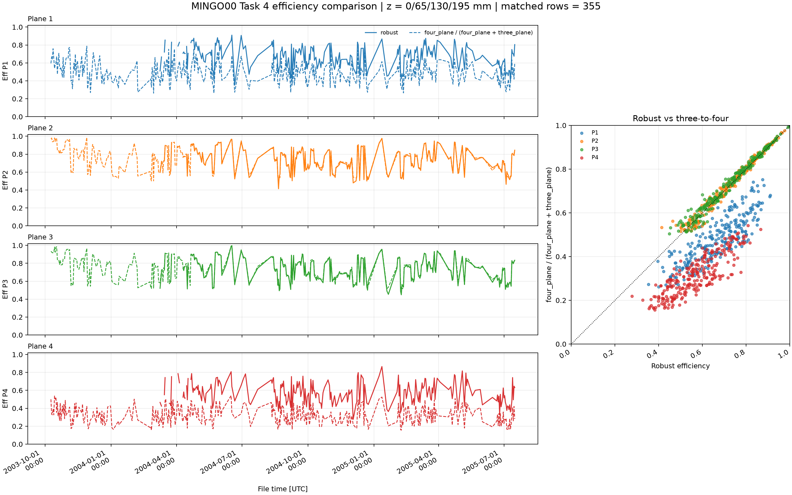
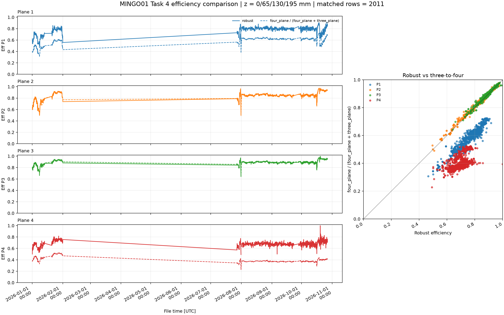

# 2026-04-17

## Real-data vs simulation agreement using robust efficiency from the median efficiency profile
---

### Observation
The regenerated figure below shows current MINGO01 Task 4 efficiency coverage over x, y and theta. The original LUT overlay is missing; this replacement is a spatial-coverage analogue based on the current metadata report.

### Key conclusion
Using the robust efficiency defined as the median of the efficiency profile along the x axis makes the simulation and real data finally look like they match.

### Notes
- The x-axis median-based efficiency is a stronger, more stable reference than a simple mean over the profile.
- When this robust efficiency is applied, the real-data efficiency coverage overlay aligns much better with the simulation prediction.
- Additional evidence from the task-4 comparison shows that the robust efficiency and the three-to-four efficiencies are not compatible in either simulation or real data.
- In contrast, the robust method's efficiency matches the real data extremely well.

### Figures

*Current-data coverage analogue exported from page 2 (MINGO01) of the available Task 4 efficiency metadata report. It shows the spatial efficiency coverage over x, y and theta, but does not contain the original LUT overlay or historical sample.*

*Source recorded in the entry as the Task 4 robust-vs-three-to-four output for MINGO00. Regenerate with `MINGO_ANALYSIS/MINGO_ANALYSIS_SCRIPTS/ANCILLARY/CALCULATIONS_AND_TUNINGS/ROBUST_EFF_VS_THREE_TO_FOUR_PLANE_EFF/compare_task4_robust_vs_three_to_four_efficiency.py` and the original station Task 4 metadata/configuration; those historical data are not present here.*

*Source recorded in the entry as the Task 4 robust-vs-three-to-four output for MINGO01. Regenerate with `MINGO_ANALYSIS/MINGO_ANALYSIS_SCRIPTS/ANCILLARY/CALCULATIONS_AND_TUNINGS/ROBUST_EFF_VS_THREE_TO_FOUR_PLANE_EFF/compare_task4_robust_vs_three_to_four_efficiency.py` and the original station Task 4 metadata/configuration; those historical data are not present here.*

### Source
- Plot source: `MINGO_DICTIONARY_CREATION_AND_TEST/ANOTHER_METHOD/OUTPUTS/PLOTS/step5_lut_real_efficiency_coverage.png`
- Plot source: `MINGO_ANALYSIS/MINGO_ANALYSIS_SCRIPTS/ANCILLARY/VARIOUS_TESTS/OUTPUTS/TASK_4_ROBUST_VS_THREE_TO_FOUR/MINGO00_task4_robust_vs_three_to_four.png`
- Plot source: `MINGO_ANALYSIS/MINGO_ANALYSIS_SCRIPTS/ANCILLARY/VARIOUS_TESTS/OUTPUTS/TASK_4_ROBUST_VS_THREE_TO_FOUR/MINGO01_task4_robust_vs_three_to_four.png`
- Notebook figure copies: `DOCS/NOTEBOOKS/2026/04_APRIL/FIGURES/step5_lut_real_efficiency_coverage.png`, `DOCS/NOTEBOOKS/2026/04_APRIL/FIGURES/MINGO00_task4_robust_vs_three_to_four.png`, `DOCS/NOTEBOOKS/2026/04_APRIL/FIGURES/MINGO01_task4_robust_vs_three_to_four.png`
