# The efficiency correction and the flux estimation

The method consists in the following, and its extremely simple.

## Long range measurements

### Simulation

We simulate the detector for the geometries that we are interested in. With this simulation, we can actually assign the real efficiency value per plane and relate it to the value obtained with the acceptance effects, so we can obtain a "true" efficiency. This relation is portrayed in the following figure. There is a 3-order polynomial fitted, so that we can obtain directly, from a certain "empirical effifiency", the simulated corresponding efficiency.

*Regenerated calibration analogue from available MINGO00 simulation Task 4 metadata: it compares per-plane robust efficiencies with three-to-four efficiencies and fits the relation. This current sample and geometry differ from the lost long-range simulation.*

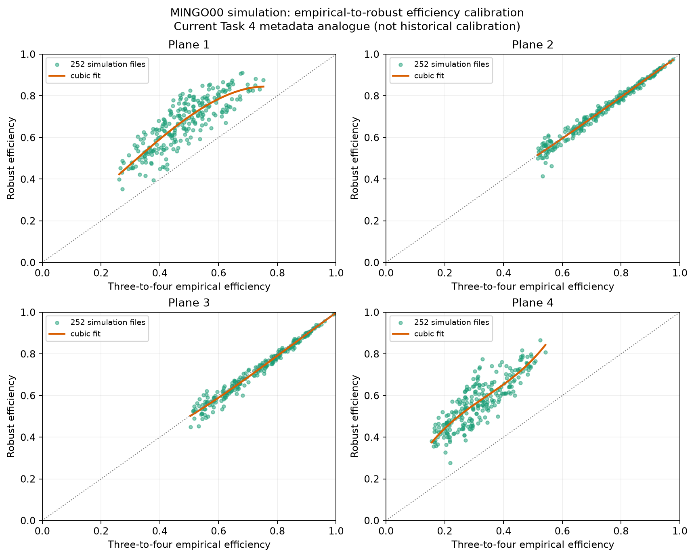

This was all simulates data, but we have now the tool to correct truly by the acceptance.

### Real data

Now we start working with the real data.

We obtain four values of the efficiency, simply doing detected / passed, within a fiducial range using the fitted tracks. This is important. So we simply do:

$eff_1 = \frac{1234}{234 + 1234}$

And same for other planes.

The time series, for example for mingo01 (Madrid) for summer 2024 (june to september), for the "empirical" efficiencies with the corrected versions are:

*Regenerated from current MINGO01 Task 4 robust-efficiency metadata. The 2026 per-plane series serves the same purpose as the missing empirical-efficiency time series; the original summer-2024 period is absent.*

This time of the year is selected because there were some strong temperature changes:

*This figure belongs to the efficiency-correction/flux-estimation workflow described in this section: simulated efficiency calibration (Step 0), real Task 4 efficiency/rate metadata (Steps 1–2), or simulation rate-to-flux calibration (Step 3). Recreate it by rerunning the corresponding workflow with the original simulation, station/date selection and configuration; the notebook does not preserve those input files or an exact script/config path.*

that made the efficiency change clearly.

Then we calculate the product of the four efficiencies, which will be called eff_reference:

*Regenerated from current MINGO01 Task 4 robust efficiencies; the plotted reference is their four-plane product. It illustrates the same scaling quantity on the available 2026 sample.*

and simply invert it, so we have the factor 1/eff_reference that will be used to correct the **four plane rates**:

*Regenerated from current MINGO01 Task 4 robust efficiencies as the inverse of their four-plane product. It illustrates the rate scale factor on the available 2026 sample.*

that, for this period, goes from 30% to 90% increment on the four plane rate.

Simply applying this factor, based on the efficiency in each point, blindly on the data, since it does not use in any instant correlation between close points, temperature or pressure, only pure efficiency calculated by detected / passed, we obtain this time series:

*Regenerated from current MINGO01 Task 4 rates and robust-efficiency metadata. The corrected curve divides the selected four-plane rate by the product of per-plane robust efficiencies; it uses 2026 data rather than the lost 2024 period.*

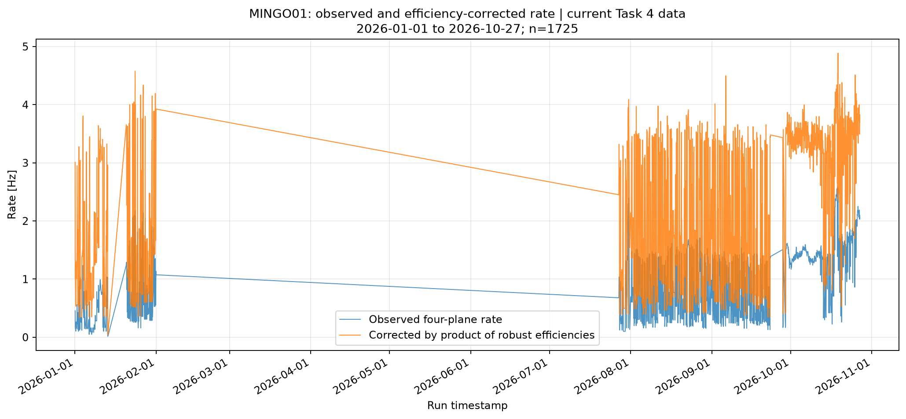

Which by itself is not a full check, though it looks good, that it's corrected nicely. To obtain that check, we simply plot the correlation between the original and the corrected data:

*Regenerated from current MINGO01 Task 4 rates and robust efficiencies, plotting corrected rate against the four-plane efficiency product. It serves the same correction-diagnostic purpose on the available 2026 sample.*

Which simply by fitting a trend shows that *the corrected rate is indeed the rate that would be if the efficiency extrapolation was up to 1, that is, total detection*. I consider this a good proof that the efficiency correction, at least in a long-three month period with strong temperature and pressure variations, is OK.

### Flux estimation - back to simulation

Since the simulation uses as input parameter a estimated flux, we can indeed establish a relation between the measured rate of events and the original flux entering the detector.

*This figure belongs to the efficiency-correction/flux-estimation workflow described in this section: simulated efficiency calibration (Step 0), real Task 4 efficiency/rate metadata (Steps 1–2), or simulation rate-to-flux calibration (Step 3). Recreate it by rerunning the corresponding workflow with the original simulation, station/date selection and configuration; the notebook does not preserve those input files or an exact script/config path.*

So we simply take the line that, for the closest possible to eff = 1 in all planes, relates the measured rate with the simulated flux.

Applying this relation to the already shown corrected data, we can obtain the total flux entering the detector.

*This figure belongs to the efficiency-correction/flux-estimation workflow described in this section: simulated efficiency calibration (Step 0), real Task 4 efficiency/rate metadata (Steps 1–2), or simulation rate-to-flux calibration (Step 3). Recreate it by rerunning the corresponding workflow with the original simulation, station/date selection and configuration; the notebook does not preserve those input files or an exact script/config path.*

## Short range measurements

### mingo01

What about a short range test? Same procedure applied to the HV scan performed in mingo01 during 2024-09-23 to 2024-10-05 is shown below.

Since this is a different geometry: equidistant, close planes, we recalculate the relation between efficiency measured and "true". We can see that there are few points: they are currently processing more.

*Regenerated calibration analogue from available MINGO00 simulation Task 4 metadata. It compares robust and three-to-four efficiencies; the exact historical HV-scan geometry and simulation sample are unavailable.*

Using the polynomials obtained in the previous plot, we show efficiency corrected by acceptance:

*Regenerated from current MINGO01 Task 4 robust-efficiency metadata. This 2026 time series illustrates per-plane efficiency variation; the historical HV-scan interval is not available.*

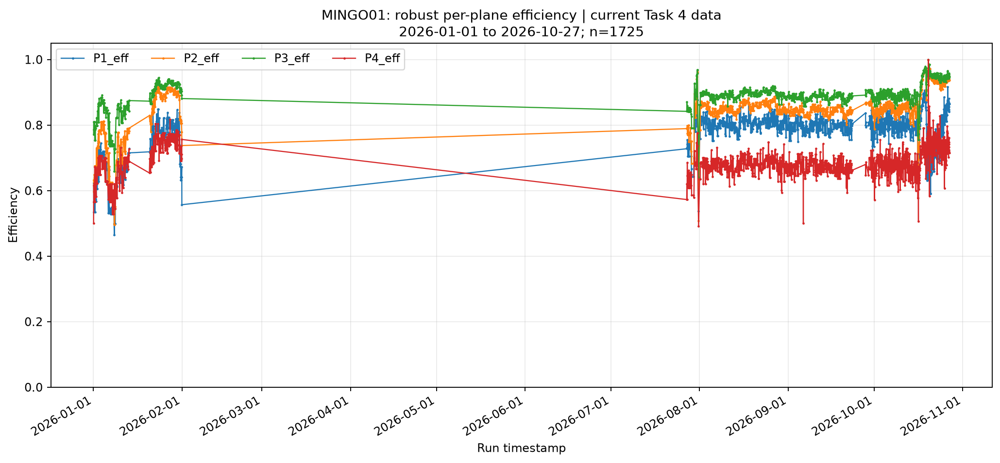

Efficiencies corrected together, along with its product:

*Regenerated from current MINGO01 Task 4 robust efficiencies as their four-plane product. It illustrates the reference-efficiency behavior on current data, not the lost HV scan.*

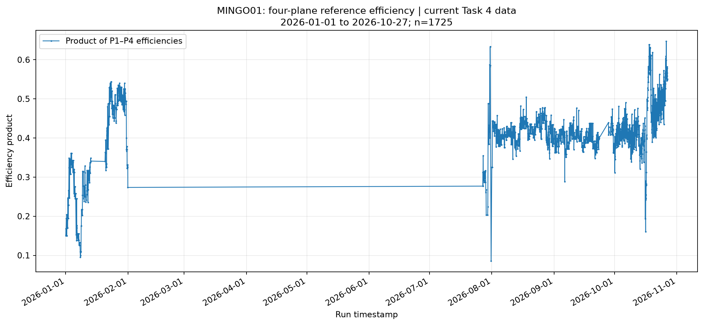

Which represent a factor of scale to the four plane rate as shown. Note the correction during the high voltage scan goes from 200% up to a 900% of the rate, which is indeed a very large value, more that we ar  usually going to need to correct.

*Regenerated from current MINGO01 Task 4 robust efficiencies as the inverse four-plane product. It illustrates the correction factor on current data, not the lost HV scan.*

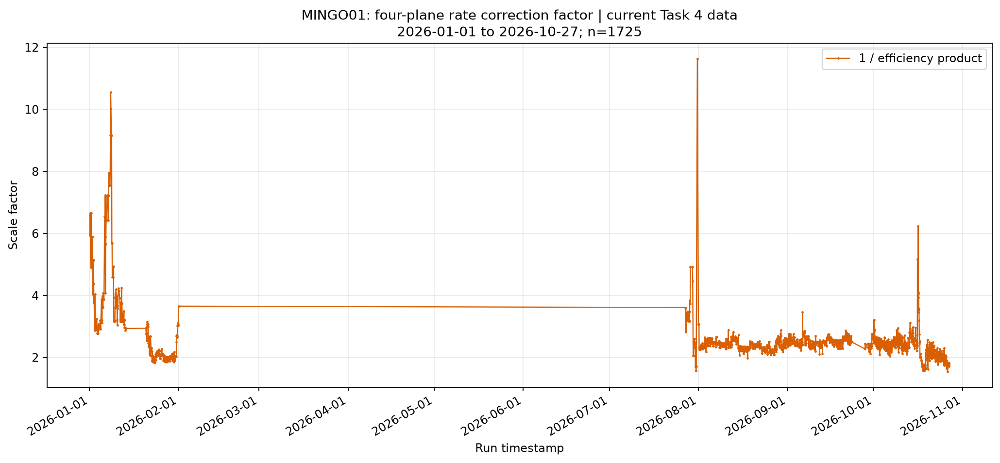

This gives a corrected rate as follows.

*Regenerated from current MINGO01 Task 4 rates and robust efficiencies. The selected rate is corrected by the efficiency product; the original HV-scan period is absent.*

And the correlation of the rate with the efficiency product is not fully flat, especially for the low efficiency values, but we are working on it, and it's good enough to show this is possible.

*Regenerated from current MINGO01 Task 4 metadata to show corrected rate versus efficiency product. It is a current-data analogue; the original HV-scan data are absent.*

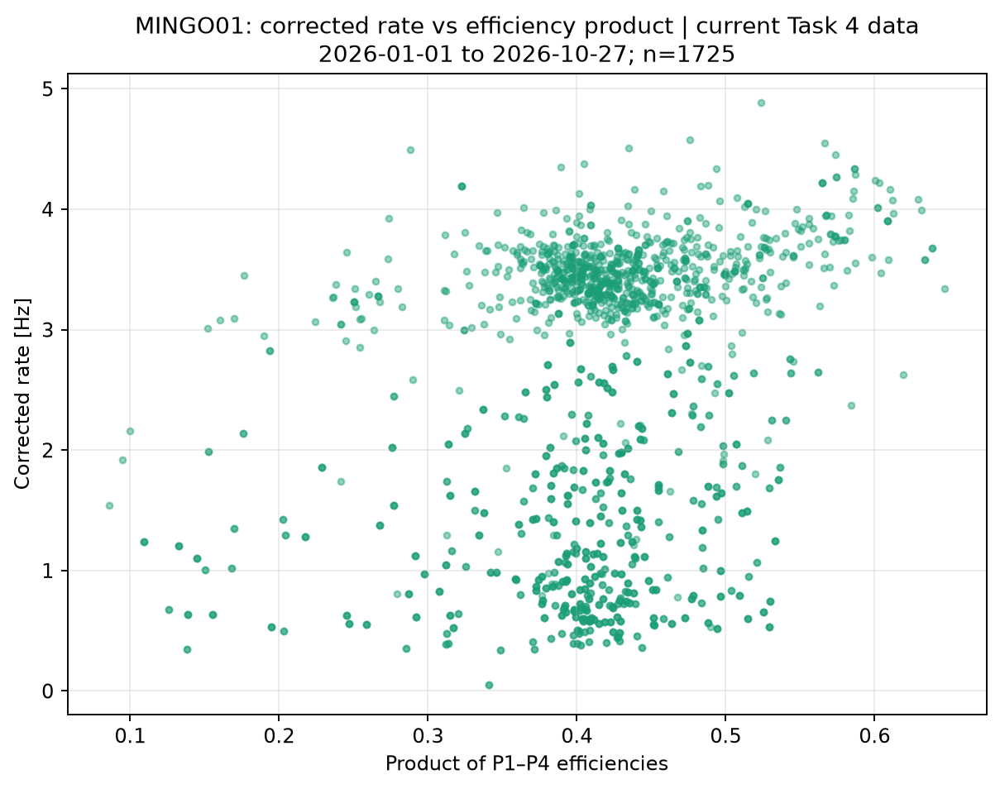

Which serves as a proof that we can correct a high voltage scan, up to some point.

### Other stations

#### mingo02 - Warsaw

We show very quickly the mingo02 HV scan. The efficiency during the scan:

*Regenerated from current MINGO02 Task 4 robust efficiencies as their four-plane product. This shows the same reference-efficiency quantity on current 2026 data, not the lost HV scan.*

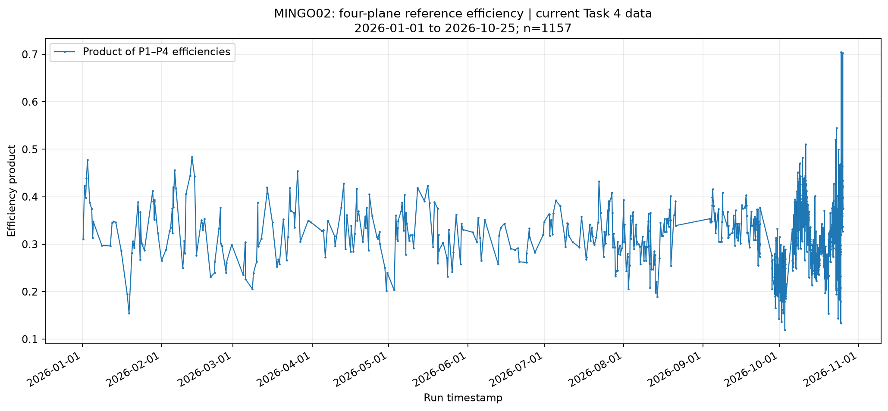

The corrected rate:

*Regenerated from current MINGO02 Task 4 rates and robust efficiencies, correcting the selected rate by the four-plane efficiency product. It is a current-data analogue, not the historical scan.*

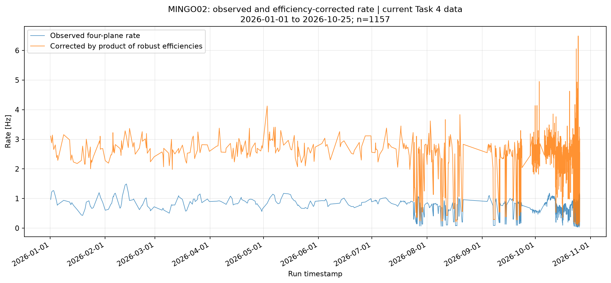

And the correlation plot:

*Regenerated from current MINGO02 Task 4 rates and robust efficiencies to show corrected rate versus efficiency product. It is a current-data analogue, not the historical scan.*

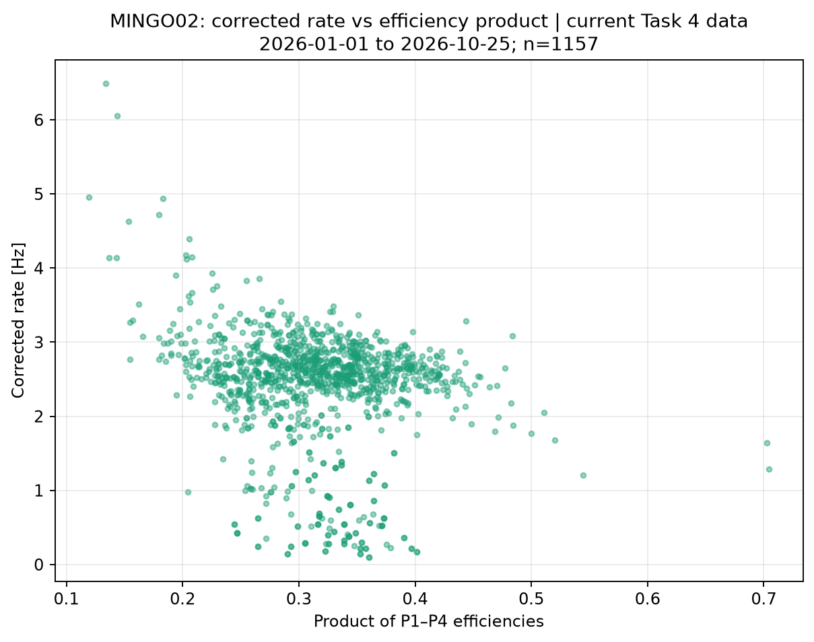

#### mingo04 - Monterrey

And the mingo04 HV scan (2025-02-25 to 2025-03-10):

*Regenerated from current MINGO04 Task 4 rates and robust efficiencies, correcting the selected rate by the four-plane efficiency product. It is a current-data analogue, not the historical scan.*

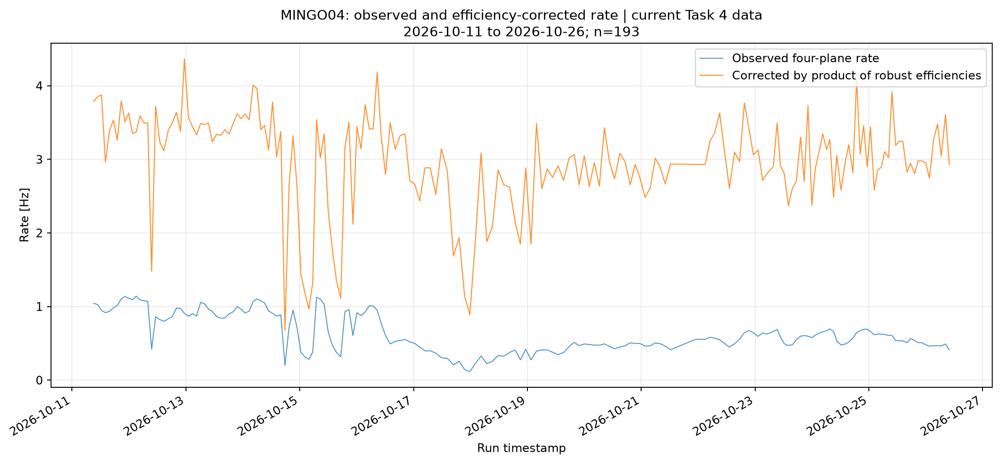

*Regenerated from current MINGO04 Task 4 rates and robust efficiencies to show corrected rate versus efficiency product. It is a current-data analogue, not the historical scan.*

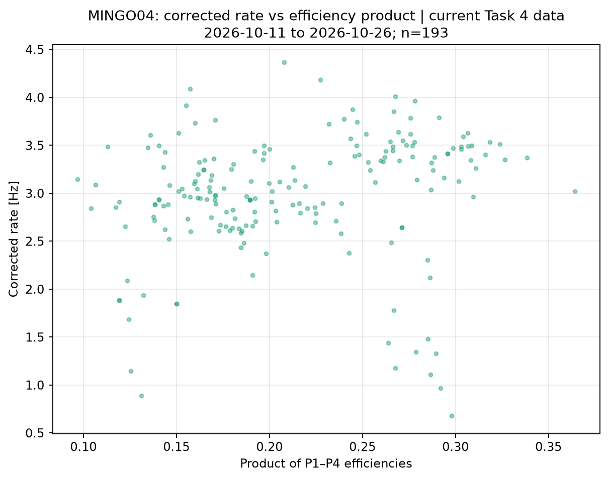

mingo04 looks so out of the plateau that the HV scan does not even have a remarkable impact on the efficiency, which itself has a strong variation due to the temperature changes:

*Regenerated from current MINGO04 Task 4 robust-efficiency metadata. This 2026 series serves as an efficiency-variation illustration; the original station period is not present.*

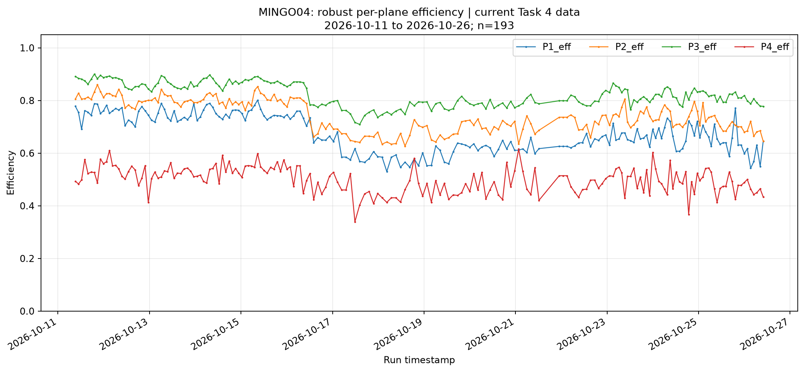

See the HV:

*This figure belongs to the efficiency-correction/flux-estimation workflow described in this section: simulated efficiency calibration (Step 0), real Task 4 efficiency/rate metadata (Steps 1–2), or simulation rate-to-flux calibration (Step 3). Recreate it by rerunning the corresponding workflow with the original simulation, station/date selection and configuration; the notebook does not preserve those input files or an exact script/config path.*

And the temperature:

*This figure belongs to the efficiency-correction/flux-estimation workflow described in this section: simulated efficiency calibration (Step 0), real Task 4 efficiency/rate metadata (Steps 1–2), or simulation rate-to-flux calibration (Step 3). Recreate it by rerunning the corresponding workflow with the original simulation, station/date selection and configuration; the notebook does not preserve those input files or an exact script/config path.*

## Important remark - That we already discussed

Note that the correlation plot of rate vs efficiency has a nuance. We should expect that the correction is fully flat with the efficiency, because efficiency depends on pressure, because of detector effects, but also the flux depends on pressure, due to cosmic ray physical effects. This means that we should not expect ideally the corrected flux to be totally independent of the efficiency. Instead, we should aim at the extrapolation at eff = 1 to be coincident. This is the criteria that the correction makes sense. And this is why the simulation is needed, and every other method that i tried to correct the rate trying to totally decorrelate the efficiency is not physically right.

## Conclusions

We have shown an efficiency correction for three months of data for mingo01, as well as a real flux estimation. This are not arbitrary units, but true physical units that can be compared between stations.

Then we have shown high voltage scans for mingo01, 02 and 04, with this method applied for correction.

Data has many blank spaces due to preliminar analysis, more is being processed as this is being written.

Fiducial ranges can be made thinner, better, this is something to work on.

In any case, we see that it's possible to correct the efficiency variations, and even give a flux value for the number of events crossing the detector.
