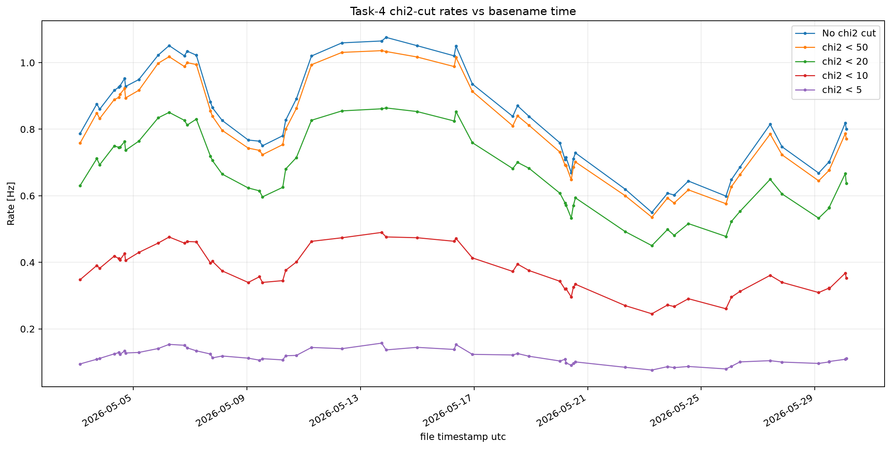
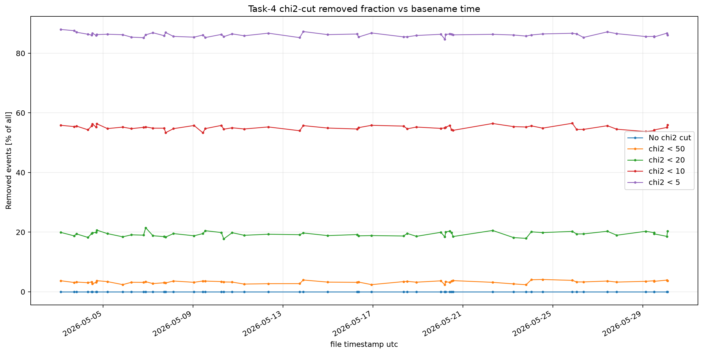

# 2026-05-08

## Chi2 cut quick test

The chi2 cut may not be a bad criterion. This should be further investigated.

*Regenerated analogue with the available MINGO02 Task 4 chi-square metadata for May 2026 (55 records), using no cut and exploratory thresholds χ² < 50, 20, 10, and 5. The original station and thresholds were not preserved, so this shows the same cut-rate behavior rather than the exact May 8 result.*

*Regenerated alongside the rate plot from those MINGO02 May 2026 records. It shows the fraction removed at the same exploratory χ² thresholds; the original station/threshold selection is unknown.*

