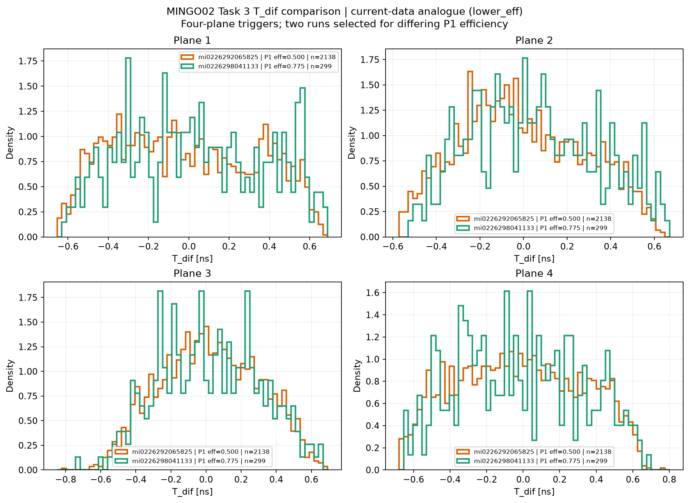
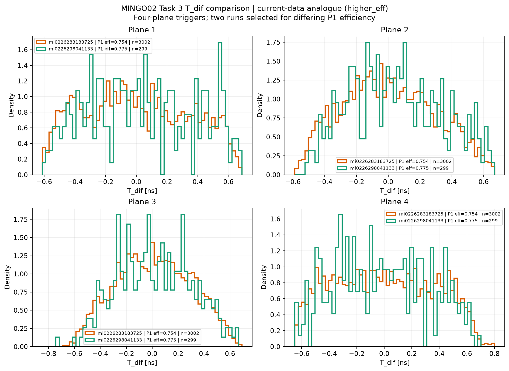

# 2026-05-27

## Task 3 T_dif final comparison — current-data analogue

The first current-data analogue compares two MINGO02 runs with a larger difference in P1 robust efficiency. It tests the same idea that efficiency mismatch can change the Task 3 T_dif distributions. Both files are real-data runs; the original MINGO00 simulation files are unavailable.

`MINGO02 mi0226292065825` (P1 efficiency 0.500) vs `MINGO02 mi0226298041133` (0.775)

*Regenerated current-data analogue from two MINGO02 postprocessed parquet files in the Stage 1 products lake. It compares four-plane `T_dif` distributions for runs with P1 efficiencies 0.500 and 0.775. This is data-to-data and uses trigger 1234; it illustrates efficiency-dependent shape changes but does not reproduce the lost MINGO00 simulation comparison.*

The second analogue compares two current MINGO02 runs with closer P1 robust efficiencies:

`MINGO02 mi0226283183725` (P1 efficiency 0.754) vs `MINGO02 mi0226298041133` (0.775).

*Regenerated current-data analogue from two MINGO02 postprocessed parquet files in the Stage 1 products lake. It compares four-plane `T_dif` distributions for runs with P1 efficiencies 0.754 and 0.775. This is data-to-data and uses trigger 1234; it illustrates the same efficiency-match question, not the original simulation comparison.*

