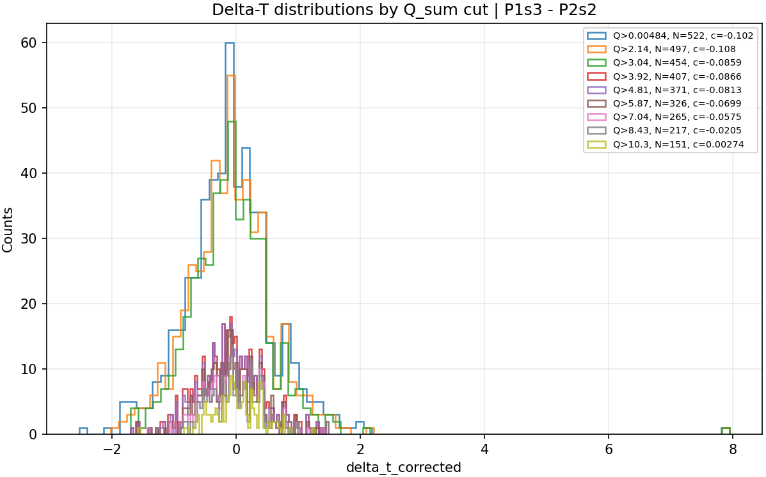

This is suspicious:

*Recovered original diagnostic plot from the supplied recovered documentation archive.*

It looks like the cut affects extremely the number of counts, but it's probably because of the bin size, now that I realize...
