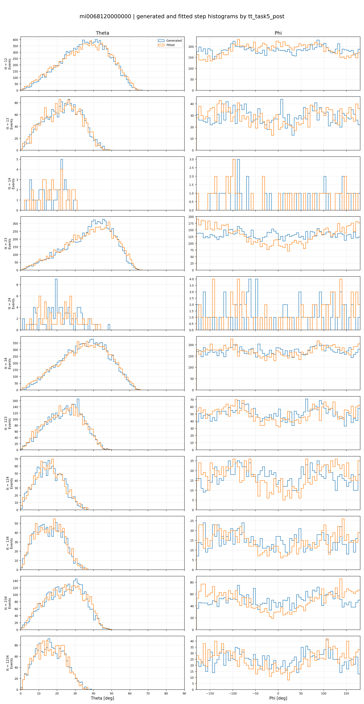

So this is from the simulated data. You can see that the strange azimuthal assymetries are already there in the generated data, that is, the traces that enter the telescope. And then the fit makes them even worse.

*Recovered original generated-versus-fitted diagnostic from the supplied recovered documentation archive.*

And this was essentially thanks to the tuning that i have made so that the tdif distributions would fit, etc.

This tells me that maybe it's not perfect (the analysis) and that i changed the length of the strips in the simulation only to adatp to the data instead of making the speed of the signal different so that the data would match the simulation. I really need to think about this, but this is a good breakthrough: the simulated data presents some key features of the real data.

---

Summary of the code:

`MINGO_SIMULATION_VS_SIMULATION/compare_sidecar_with_simulated_data.py` compares
the Monte Carlo angular ground truth stored by STEP_FINAL with the angles
reconstructed by the complete Stage-1 analysis pipeline.

The script selects one Task-5 `postprocessed_*.parquet` file from the MINGO00
`STAGE_1_PRODUCTS/EVENT_DATA/PARQUET_LAKE` directory. By default it uses the newest file, although a
specific file can be supplied with `--input-file`. It removes pipeline prefixes
from the filename, finds the corresponding
`sidecar_<mi-basename>.parquet`, and performs a one-to-one inner join on
`event_id`. This is the central comparison: both tables refer to the same
physical rows of the original simulated `.dat` file.

From the postprocessed file it reads:

- `tt_task5_post`, used to separate the results by accepted plane combination;
- the fitted direction, normally `event_theta` and `event_phi`.

From the STEP_FINAL sidecar it reads:

- generated `Theta_gen` and `Phi_gen`;
- optional traceability variables such as `sim_event_id`, `T_thick_s`,
  `X_gen`, `Y_gen`, `Z_gen`, and `station_datetime`.

The code accepts several legacy candidate names for the generated and fitted
angle columns. It also detects whether angles are already expressed in degrees
or remain in radians. Azimuths are wrapped into `[-180, 180)` before comparison.
For each matched event it calculates:

- generated and fitted theta and phi in degrees;
- `theta_residual_deg = theta_fitted_deg - theta_generated_deg`;
- the wrapped shortest azimuthal residual, avoiding a false discontinuity at
  `-180/180` degrees;
- the full spherical angular separation between generated and fitted
  directions.

The figures are grouped by `tt_task5_post`, allowing the reconstruction quality
and angular acceptance to be inspected separately for each plane combination.
The principal diagnostics are:

- generated-versus-fitted theta and phi step histograms;
- generated and fitted angular phase-space plots, coloured by angular residual;
- angular-bin migration matrices, globally and per `tt_task5_post`;
- configured angular-region migration matrices;
- generated and fitted angular-region occupancy maps.

The angular-region definitions are read from the Stage-2 accumulation configuration.
The script also reads `step_final_simulation_params.csv` to annotate plots with
the simulation `param_set_id`, `param_hash`, and the four configured plane
efficiencies.

Outputs are written under `MINGO_SIMULATION_VS_SIMULATION/PLOTS`. They include a
consolidated diagnostics PDF, PNG figures, migration-matrix CSV tables, angular
region occupancy tables, and a per-`tt_task5_post` residual summary containing
event counts and the mean/RMS theta, wrapped-phi, and total angular residuals.
With `--write-merged`, it additionally writes the joined event-level comparison
table as a compressed parquet file.

This comparison distinguishes effects already present in the generated
directions from distortions introduced or amplified by detector response and
the reconstruction fit. In particular, a feature visible in `Theta_gen` or
`Phi_gen` cannot originate exclusively from Task 4 fitting; differences between
the generated and fitted distributions quantify the additional reconstruction
effect.
