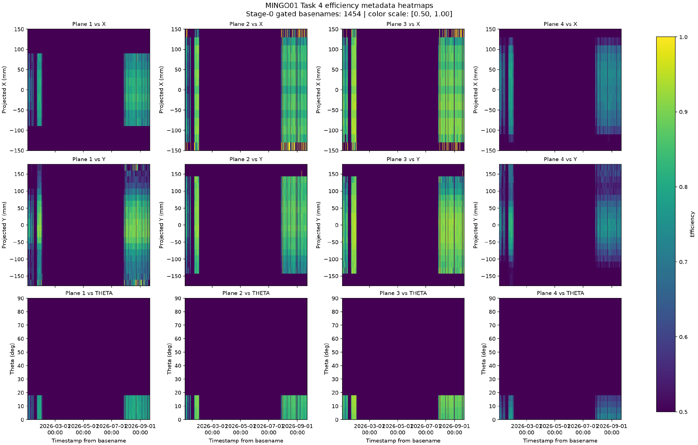

Current Task 4 efficiency map analogue (spacer view unavailable)

*Current-data efficiency-map analogue exported from the available MINGO01 Task 4 metadata report. It shows spatial efficiency coverage, but it is not the original gate-8192 map and does not show that run’s spacer pattern.*

