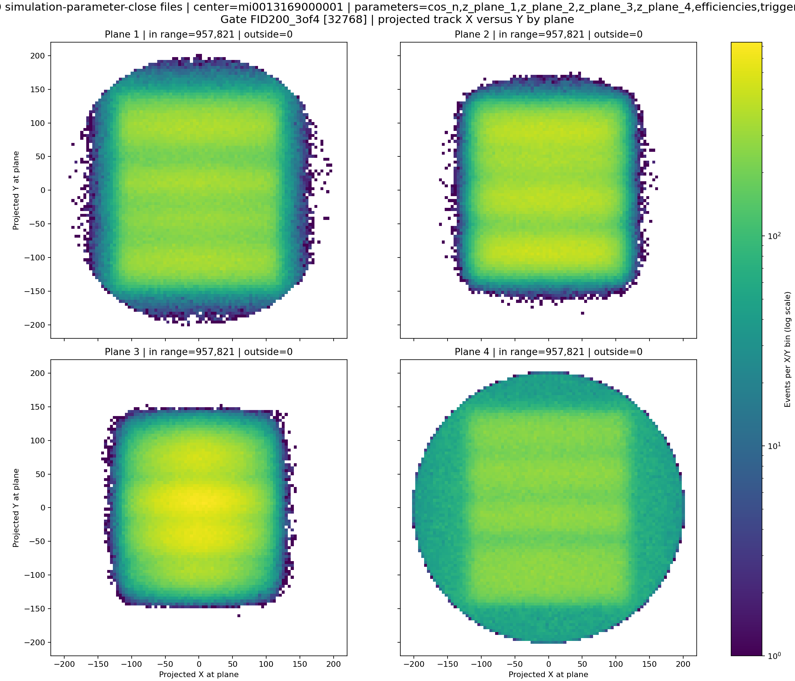
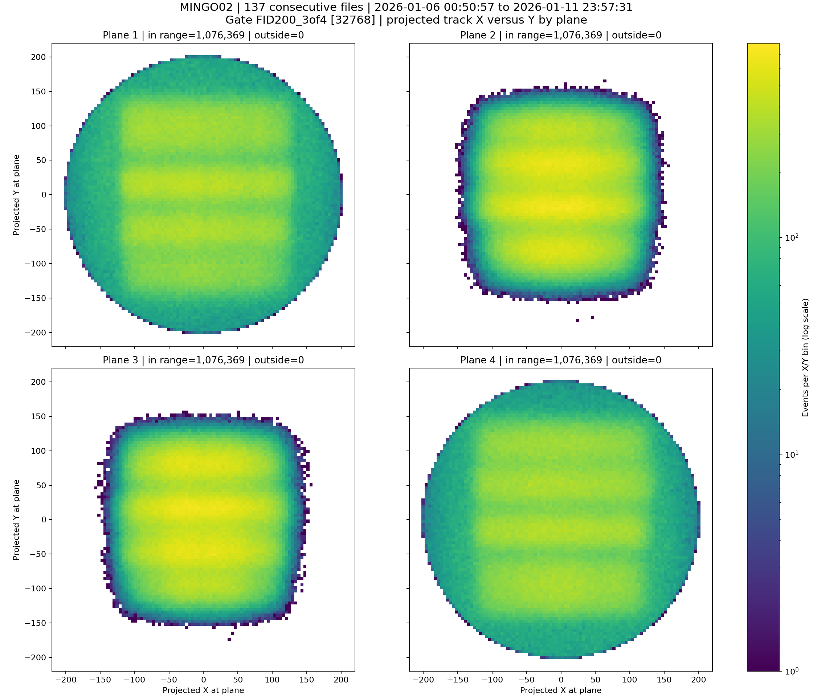
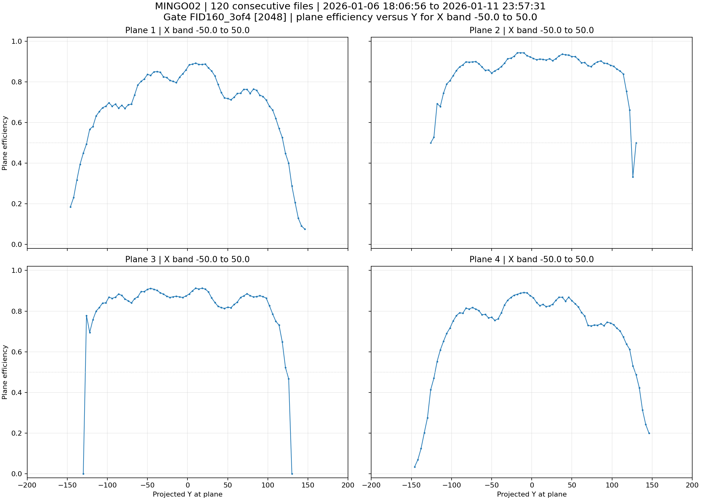
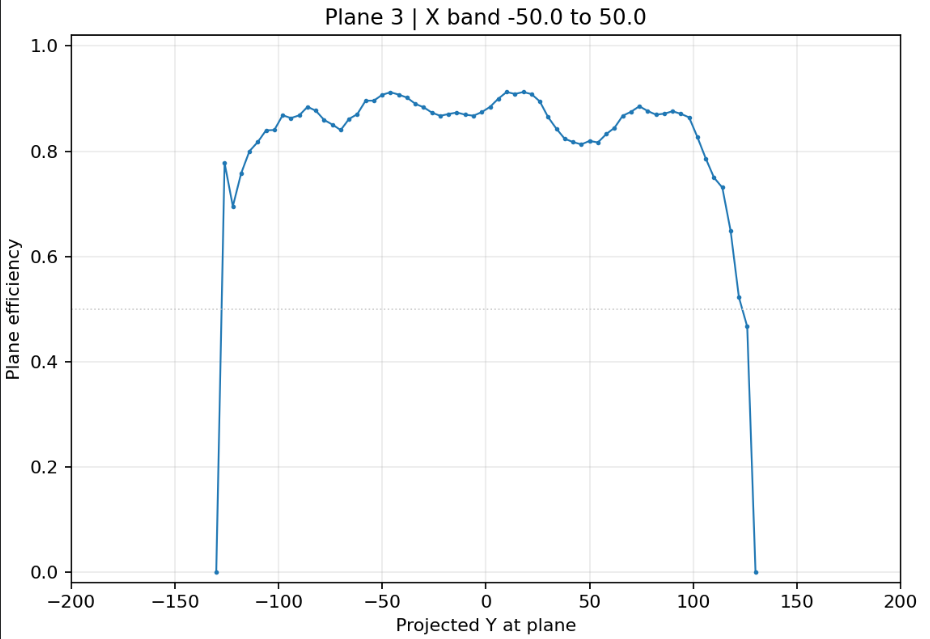

# Plane XY histograms

Simulation:

*This is the plane-position histogram for the gate-32768 MINGO00 simulation. Recreate it by running the Task 4 XY-plane histogram plotter on the corresponding original run with gate 32768 and the same geometry/configuration; those run files are absent here.*

Measurement:

*This is the plane-position histogram for the gate-32768 MINGO02 measurement. Recreate it by running the Task 4 XY-plane histogram plotter on the corresponding original run with gate 32768 and the same geometry/configuration; those run files are absent here.*

MINGO02 efficiency profile (gate 2048):

*Recovered original efficiency profile from the supplied recovered documentation archive.*

The plane 3 close-up shows the efficiency drop associated with the spacer region.

*Recovered original detail plot from the supplied recovered documentation archive.*

