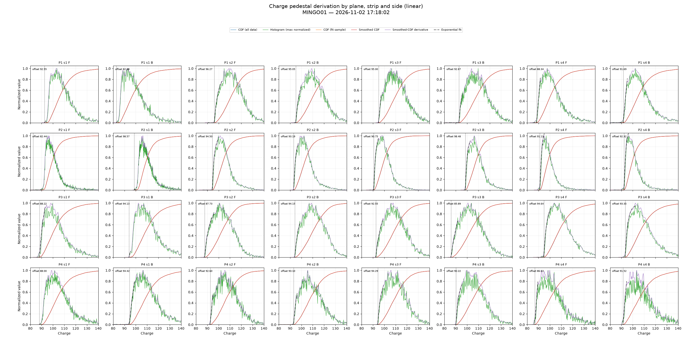
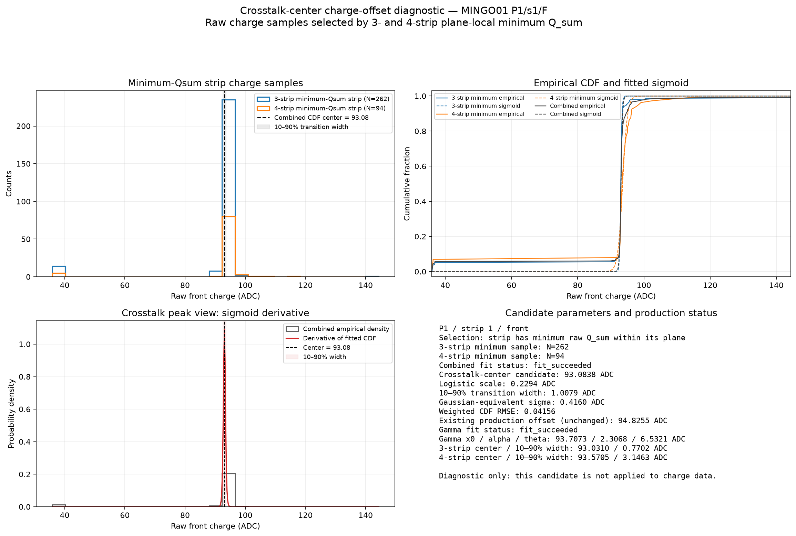

# 2026-11-04 — Charge spectrum width and plane efficiency

## MINGO01 Task 2 charge pedestal sample

The latest Task 2 4×8 charge-pedestal derivation figure shows a clear pattern: planes operated at the same HV appear to have identical charge-spectrum widths, while Plane 2 has a lower/narrower spread. During this data period Plane 2 was at a lower HV because it was being scanned.

This is an observation and a useful hypothesis, not yet a demonstrated causal relationship. As Alberto has suggested, charge-spectrum width may be strongly correlated with the efficiency of the corresponding plane. If confirmed, this could provide an informative detector-response observable during HV scans.

The figure compares `working_df` with the exact per-channel values entering the pedestal estimator, after the configured fit selection and maximum-strip filter. The visible charge range is 50–120; the panels also report the full fit-sample count and the count inside that displayed range.

## Methodological caveat: exact one-strip samples

Selecting events with exactly one active strip is not a neutral way to obtain a single-gap charge reference. It explicitly selects avalanches that did not produce detectable charge in neighboring strips, excluding charge-sharing and broader responses. The selected per-strip spectrum can therefore be biased toward lower charges than the underlying avalanche population. Keep the one-strip curve as a topology-conditioned comparison, and assess it alongside inclusive three/four-strip samples and their per-plane minimum/second-minimum strips before using it as a single-gap template.

## Follow-up

For each acquisition interval, pair the charge-width measurements with the actual CAEN HV and a plane-efficiency estimate from the same interval. Check front/back and strip dependence, quantify uncertainty, and account for pressure, temperature, fiducial acceptance, track angle, and the pedestal-fit sample selection. Do not interpret the visual correlation alone as proof that HV causes the efficiency change.

The analysis is tracked in the [essential future-work list](../../../ESSENTIAL/todo.md#essential-charge-width-versus-hv-and-plane-efficiency-study).

## Exploratory crosstalk-center charge offset

Task 2 now also estimates a diagnostic charge-zero candidate from the minimum-`Q_sum` strip in planes with exactly three or four active strips. For each plane/strip/front-back channel, it takes that channel's raw charge in the three-strip and four-strip minimum-strip samples, fits a sample-weighted logistic sigmoid to each empirical CDF and their combined CDF, and records the combined transition center plus logistic scale and 10–90% transition width. The fit weights ADC values according to how many selected events have that value, so the dense peak sets the transition more strongly than sparse tails.

The candidate is deliberately **not applied**: the existing derivative-based pedestal offset remains the production method, and the shifted-gamma fit remains a separate diagnostic of where the real avalanche spectrum begins. The crosstalk center is a test of the alternative convention “put zero at the center of the crosstalk peak.” Calibration metadata now carries the crosstalk center, scale, width, separate 3-strip/4-strip centers and sample counts, along with the derivative offset candidate and gamma x0/shape/scale candidates. These can later be compared with temperature, pressure, HV and time without losing the present production calibration.

For the MINGO01 `cleaned_mi0126308105321` sample, after the configured Task-2 main cuts, P1/s1/front had 262 three-strip minimum-Qsum entries and 94 four-strip minimum-Qsum entries. The combined crosstalk-center fit was 93.0838 ADC with a 1.0079 ADC 10–90% transition width; the existing shifted-gamma fit gave x0 = 93.7073 ADC, and the existing production offset was 94.8255 ADC. These are first diagnostic values, not validation: the narrow transition and differences among the three estimates need to be checked across channels and files. The 3-strip and 4-strip fits should also agree before treating the combined center as a stable reference.

