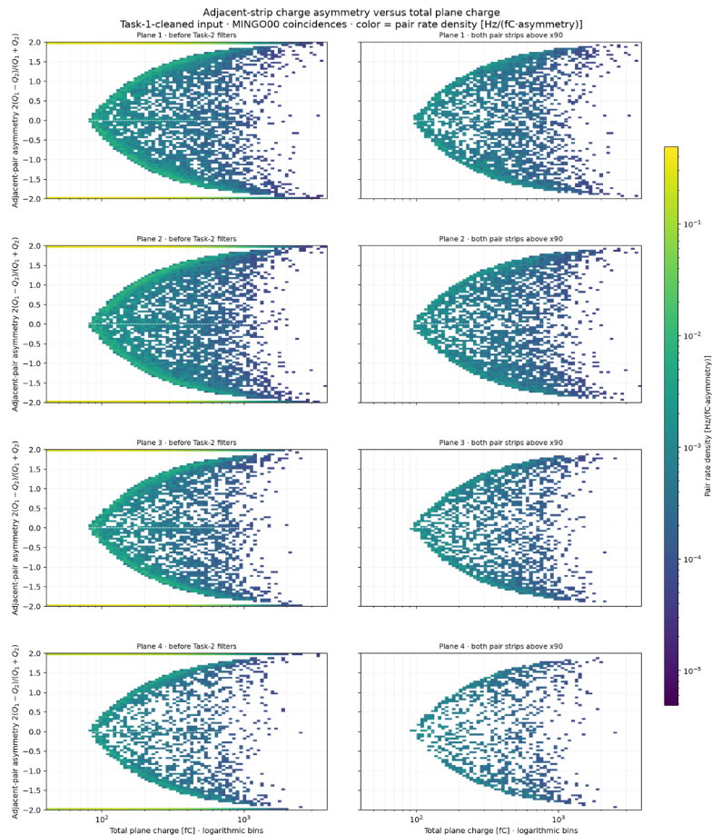
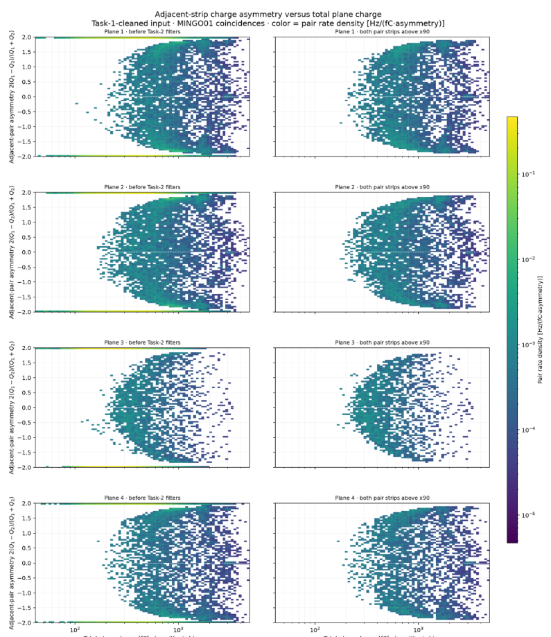

# 2026-11-10 — Adjacent-strip smile plots

This plot suggests that the lower charges in the 2 strip sharing are not measured, so, in a way we didn't expect, we have less efficiency for the two strip events than for the one strip events, because in one strip events, because the charge is not splitted in between two strips but all in one, is most likely going to surpass the threshold. This would mean that, for a potential correction, different efficiencies would be expected for one strip events and for two strip events.

## Simulation charge threshold: verified behavior and follow-up

The digital-twin simulation **does apply a charge threshold** in STEP_8, `step_8_uncalibrated_to_threshold.py`. The active physics config sets `charge_threshold: 0.13792`; its comment identifies this as approximately **60 fC** under the configured inverse ToT calibration. STEP_8 first converts each nonzero front/back strip charge from fC to ToT width in ns, then independently sets each front/back value below 0.13792 ns to zero, and only after that applies the configured charge offsets. Thus this is an end-by-end electronics threshold in the simulated response, before trigger formation, rather than the later analysis x90 cut used in the charge-spectrum inefficiency study. If the calibration file is unavailable, STEP_8 switches to its documented linear fallback, so the same numeric threshold is then applied to the fallback-converted width; that case should be identified when interpreting a run.

**Follow-up for the charge-spectrum inefficiency study:** explicitly trace the exact STEP_8 calibration/fallback and threshold used by each MINGO00 file, then propagate that response to the sidecar-based denominator. Compare (1) configured intrinsic plane efficiency, (2) the STEP_8 thresholded detection efficiency for true plane crossings, and (3) the reconstructed charge-spectrum extrapolation and TT miss estimate, separately by cluster size. The existing direct sidecar comparison based on reconstructed x90 hits is not automatically the same as the simulated electronics-threshold efficiency. This distinction is essential before treating the gamma-extrapolated missing area as a detector inefficiency.
