# 2026-11-11 — Trace fitted data/simulation differences upstream

## Interpretation rule

**A good-looking downstream distribution does not establish that the effect is physics. Any discrepancy in theta or another derived variable must be traceable to its inputs in an earlier stage.** Begin at Task 1 when needed, then follow the same events and strips through Task 2 calibrated Tdif/Tsum/Qdif/Qsum, Task 3 listed plane quantities, and Task 4 fitted variables. A downstream mismatch can be inherited from a small or localized upstream population even when the pooled upstream histogram looks acceptable.

Do not assume a Tdif value is invalid because it is zero or near zero. Zero can be a physical timing difference; retain finite values and inspect the corresponding strip's timing, charge, plane, trigger, and event selection before proposing a cut.

## Current comparison

The shared task-by-task runner compares MINGO01 `mi0126314063710` against four efficiency-matched MINGO00 files. The active profile includes TT12, TT23, TT34, TT123, TT234, TT134, TT124, and TT1234. General task comparisons include the configured gates; the focused angle-position figures show no extra gate and a Task-1 cluster-size-1 gate. Figures are under `PIPELINE/MINGO_COMPARISONS/MINGO_SIMULATION_VS_DATA/TASK_BY_TASK_COMPARISON/PLOTS/TASK_1/` through `TASK_4/`.

Each downstream task folder repeats upstream plots when the corresponding product columns are available. The filename source-stage suffix makes lineage explicit. Compare matching trigger/gate prefixes across folders before attributing a fitted difference to physics. Use the scatter plots and per-strip rows to locate which Tdif populations drive it.

The current first-pass fitted comparison has median Jensen–Shannon distance 0.091 with no extra gate and 0.095 with the cluster-size gate. Four-plane fitted chi-squared has median distance 0.232 and 0.240, respectively. These are aggregate shape scores; they do not identify a causal stage. Chi-squared is defined only for TT1234 in the current products.

The cluster-size gate retains 86.7% of the selected data events and about 96.3–96.7% of the selected simulation events. Any shape improvement must be considered alongside this unequal event retention.

## Upstream results from the per-strip lineage tables

The per-strip Jensen–Shannon distances show a large Tdif mismatch is already present in raw Task 1: median strip distance for TT12 is 0.710, TT13 is 0.679, TT23 is 0.808, and TT1234 is 0.784. Task 2 cleaned raw-channel distributions are identical in this comparison, so the discrepancy has not been removed at cleaning. Calibration reduces the median Tdif distance for TT12/TT23/TT1234 to 0.172/0.168/0.113, but TT13 remains at 0.485. In TT12, the largest raw per-strip distances are P2 S2 (0.991), P2 S3 (0.930), and P2 S4 (0.894); P1 S4 is also high (0.776).

Task 1 now also has raw per-active-strip `Tdif vs Tsum` and `Tdif vs Qsum` figures for every trigger and gate, in `PLOTS/TASK_1/` with the `10_TT_...raw_Tdif_vs_Tsum_Qsum.png` prefix. `11_raw_tdif_scatter_summary.csv` has per-strip correlations and counts. For the no-extra-gate view, median per-strip Spearman `Tdif vs Tsum` is weakly positive in data (TT12 0.113, TT13 0.105, TT23 0.081, TT1234 0.091), while simulation medians are near zero. `Tdif vs Qsum` medians are near zero in both. This is a data/simulation correlation difference to inspect strip by strip; it does not identify a cause by itself.

## Plane 2 Task 2 Tdif versus strip charge

Focused figures `PLOTS/TASK_2/94_TT_...__plane2_tdif_vs_qsum.png` show P2 S1–S4 for TT12, TT23, and TT1234, with cleaned Task 2 `Tdif = front time − back time` beside calibrated Task 3 Tdif. Data and the four simulations use matching event gates; only active strips are included. The scatter y-axis shows the pooled 0.5–99.5% range so the bulk can be inspected. `95_plane2_tdif_vs_qsum_summary.csv` gives per-strip Spearman correlations and signed/absolute Tdif medians and upper quantiles in data-defined Qsum quartiles, with those same charge boundaries applied to each simulation. The companion `96_TT_...__plane2_low_charge_tdif_tails.png` compares the 99th percentile of |Tdif| across all four charge quartiles.

In the no-extra-gate cleaned Task 2 products, the Tdif/Qsum rank correlations are weak (data roughly −0.01 to −0.09 by strip/TT). The typical Tdif values therefore do not change much with charge. However, the upper tail has a strong low-charge concentration in data: across P2 strips and TT12/TT23/TT1234, the data 99th percentile of |Tdif| in the lowest Qsum quartile is about 8–115 stored units, versus about 1.6–3.1 in the highest quartile. Simulation values are roughly 2–4 across both ends. For example, TT12 P2 S2 has a low-charge |Tdif| 99th percentile of 115 in cleaned Task 2 versus 3.1 at high charge; simulations are about 2.2–2.3 at both ends. This explains why rank correlations and medians alone missed the issue: rare but very large low-charge Tdif outliers drive the discrepancy.

The same signature remains after calibration: for TT12 P2 S2 the data low-charge |Tdif| 99th percentile is 58 versus 0.8 at high charge, while simulations are about 0.6 at both ends. Across the plane-2 strips/triggers, calibrated data low-charge tails reach about 4–58, versus about 0.6–0.8 at high charge; simulation tails remain near 0.5–0.7. So the key result is clear: the worst Tdif values are associated with low strip charge, and the mismatch is already present before calibration and persists afterward. This association is observational; it does not establish whether low charge causes the timing error or shares an upstream cause. These results are from one data file and four simulations.

To view the cut effect in data alone, `PLOTS/TASK_2/97_TT_...__data_only_plane2_cal_tdif_charge_cuts.png` overlays calibrated Tdif histograms for strip cuts Qsum > 0, 5, 10, 20, and 30. Each trigger figure has all four plane-2 strips, a full-range view, and a separately rebinned [−1, 1] core view with 0.02-unit bins. The core histogram heights retain normalization to the full selected sample, and shaded bands mark [−0.6, −0.4] and [0.4, 0.6]. `98_data_only_plane2_cal_tdif_charge_cut_counts.csv` records the number and fraction of events in each band as well as charge-cut acceptance. The target populations around ±0.5 remain visible and do not consistently shrink with higher charge cuts. For TT12 P2 S2, moving from Qsum > 0 to >30 changes the −0.5-band fraction from 20.4% to 18.9% and the +0.5-band fraction from 15.9% to 17.2%, while retaining only 27.7% of the active samples. Thus the charge cut removes many events but does not selectively remove the problematic ±0.5 populations. The Qsum-dependent extreme tail is a separate effect and should not be confused with these overlapping core populations. These are diagnostic cuts, not a final event selection.

## Task 2 Tdif calibration offset stability

`PLOTS/TASK_2/99_Tdif_calibration_offsets_last_7_days.png` plots the Task 2 `P*_s*_T_dif` metadata values. The code applies these per-strip offsets by subtracting them from Tdif, so this is the calibration constant itself, not the event-level Tdif distribution. The plotted interval is the latest seven 24-hour days available, 2026-11-04 09:52 through 2026-11-11 09:52. The metadata contains 381 distinct files in this window; the plot uses each file's latest record so repeated processing does not overweight a file. The daily red line is the median and the band is the within-day 10th–90th percentile. The daily and per-file summaries are `99_Tdif_offset_last_7_days_daily_summary.csv` and `99_Tdif_offset_last_7_days_file_summary.csv`.

I initially emphasized the daily median and understated the file-to-file variation. Across 381 distinct files, P2 S1 has a file-level 10th–90th percentile span of 0.133 ns (full range 0.400 ns), P2 S4 spans 0.123 ns (full range 0.456 ns), and P2 S2 spans 0.114 ns (full range 0.316 ns). These are substantial compared with the calibrated Tdif features around ±0.5 ns. Daily medians in the file-level plot have uneven sample counts (from 1 to 165 files on a date), so they should not be used alone to dismiss the file-to-file spread. This variation is large enough to investigate as a possible contributor to the ±0.5 populations; it does not yet prove that the calibration variation causes them.

To test the effect directly, `PLOTS/TASK_2/100_Tdif_hist_actual_vs_median_offset_last_7_days.png` compares Task-3 histograms from the actual per-file offsets against the same event samples shifted to one common median offset per strip. For each Task-3 file, the matched offset is the latest Task-2 calibration metadata record at or before that Task-3 execution; later Task-2 recalibrations are not mistaken for the value already used. The check includes 348 matched Task-3 files and keeps the same active-event sample in both histograms.

The pooled histograms are not heavily distorted by replacing file-specific offsets with the per-strip median: Jensen–Shannon distances are at most 0.048 across all strips. Plane 2 distances are 0.044 (S1), 0.023 (S2), 0.023 (S3), and 0.035 (S4). The event fractions in bands around −0.5 and +0.5 ns change by less than one percentage point for plane 2. So file-to-file offsets vary substantially, but their pooled effect on the calibrated Tdif histogram is small in this test. This does not rule out a larger effect in an individual file or a separate calibration-model issue; it rules against offset variation alone strongly reshaping the pooled seven-day histograms.

The raw Tsum mismatch is even clearer: for TT12, the median per-strip data Tsum is −115.13 while the median simulation value is −126.82 in the current stored units. Calibrated Tsum shape distances remain around 0.98–1.00 across the selected triggers. This establishes that the timing discrepancy exists before reconstruction, and that calibration has not removed the Tsum offset. The fitted theta result therefore cannot be interpreted in isolation.

Plane 2 is not yet a sufficient explanation. TT13 is the current no-plane-2 control, yet its fitted theta distance (0.246) is larger than TT12 (0.138), TT23 (0.076), and TT1234 (0.073). This points to trigger- or selection-dependent behavior as well as plane-specific effects; the comparison is only one data file and four simulations. In raw TT12 P2 S2, data Tdif has a positive Spearman correlation with Qdif (0.26), while the simulation median is near zero. This is a useful place to inspect matched event/strip samples, not proof of a particular electronics cause.

The first files to inspect are `PLOTS/TASK_4/01_TT_12__01_GATE_no_extra_gate__01_SOURCE_TASK_1.png`, which exposes the raw per-strip differences, and `PLOTS/TASK_2/92_strip_lineage_shapes.csv` plus `93_Tdif_lineage_correlations.csv`, which quantify the stage and strip transitions. Finite zero samples were retained in these figures and tables.

## Per-second event rate and burst check

`PLOTS/TASK_1/01_event_rate_per_second__no_extra_gate.png` and `02_event_rate_burst_summary.csv` add an all-trigger and per-trigger rate check. Counts include empty seconds from each file's first to last event timestamp. The run timestamps are not calendar-aligned (MINGO01 is dated 2026; selected simulations are dated 2007), so plots use each file's elapsed time and normalize rolling rate to that file's mean.

For all triggers combined, the MINGO01 rate is 13.12 events/s and the selected simulation files range from 6.85 to 15.73 events/s. The per-second Fano factors are 1.020 for data and 0.978–1.019 across simulations without the cluster gate, consistent with Poisson-like fluctuations rather than overdispersed bursts at one-second resolution. The number of seconds exceeding the Poisson 99.9% threshold is also near expectation: 2 in the 2,393-second data span and 18 total across the four simulation spans (about 21 nominally expected). The cluster gate lowers the rates but leaves Fano factors close to 1. No sub-second timestamp variation is recorded, so this check cannot detect bursts faster than one second. The four-plane TT1234 rate is 2.28/s in the data versus 0.60–1.06/s across selected simulations; that is a rate mismatch to investigate separately from burstiness.

## Next checks

- Compare raw Task 1 and cleaned Task 2 Tdif by plane/strip for TT12, TT13, TT23, and TT1234, with the same event gate used downstream.
- Follow outlier strips into calibrated Tdif, Qsum, Qdif, and Tsum, then into listed X/Y and fitted theta/xp/yp.
- Use raw Task 1 and calibrated Task 2 per-strip Tdif-versus-Tsum/Qsum scatters to identify whether unusual Tdif values coincide with charge or timing imbalance.
- Record the earliest stage where data and simulation separate, and test any proposed data cut by its shape change and event acceptance.
# 2026-11-11 — Early-propagated cluster-size-1 gate and size-2 X/Tdif view

The task-by-task comparison now includes `cluster_size_1_from_task1`: an event is retained if it has at least one strip above its file-specific Task-2 crosstalk threshold and no plane has more than one active strip. This gate is defined from calibrated strip activity, then applied by `event_id` to the earliest Task-1 products and carried through Task 5. It is a consistent event selection on existing products, not a Task-1 reprocessing or a reconstruction rerun. Compare its Task-5 theta panel with the no-extra-gate panel to see whether removing multi-strip clusters changes the data/simulation agreement.

The new Task-3 diagnostic `110_TT_*__cluster2_xpos_vs_strip_tdif_projection.png` selects exactly two adjacent active strips on each plane and plots that plane's X position against each of the two contributing calibrated strip Tdif values. Marker shape identifies S1–S2, S2–S3, or S3–S4. The marginal Tdif histograms share the scatter's y scale and bin edges. Plane X is formed from the charge-weighted plane Tdif, then scaled by the strip propagation speed; the per-event strip charges therefore determine the contribution of each strip to X.

Task-5 angle model study: compare `event_det_theta/phi` and `event_tim_theta/phi` under both no-extra-gate and cluster-size-1 selection. The uncut plots show theta and phi in two rows. The spatial square comparison is paginated in continuous sheets of up to four rows with theta, phi, slowness, each participating plane's Task-4 Qsum, and the selected upstream variables. Detached and TimTrack angles are overlaid with a transparent fill between fit methods; slowness and charge are each shown once. Qsum histograms share their x-axis range and binning across planes and regions. There are sixteen 165 mm squares spanning x/y = [−330, 330] mm, extending beyond the plane footprint. Every cell cuts both reconstructed combined `event_x` and `event_y` at z=0. The same colored region IDs appear in every histogram panel. One shared tracker map defines the fixed boundaries for all triggers and gates; it pairs a perspective tracker view with a zenithal x/y view showing the complete regions and plane footprint. In the zenithal view, +z points out of the screen. These reconstructed positions are not Monte Carlo truth. `123_angle_position_cut_shape_metrics.csv` records per-simulation angle distances; `124_angle_position_cut_shape_summary.csv` summarizes them. All angle and selected upstream-variable sheets share the `ANGLE_POSITION` page sequence and identical 16-column region layout. The first page per TT carries its title and legend; continuation pages omit the title. Sheets are rendered one at a time at 200 dpi and integrated into the PDF from disk.

The configured trigger set is TT12, TT23, TT34, TT123, TT234, TT134, TT124, and TT1234.

The comparison profile also selects upstream distributions by name in `comparison_config.json`. Its current additions are plane X, plane Y, and calibrated Tdif per active strip. They use the same event gates, trigger classes, and fixed reconstructed x/y regions as the angle plots, and show data against the simulation median and its 16–84% envelope. This makes it possible to follow a regional theta discrepancy backward into plane positions and then strip timing; a downstream mismatch should be interpreted as physics only after checking where the upstream inputs first diverge. Other listed plane and calibrated strip quantities can be enabled in that variable list without changing the plotting code.

The calibrated per-strip Tdif comparison now has a configured [−1, 1] ns display/shape interval. Values outside that interval are clipped out of the red/blue in-range distributions and shown separately in orange for data and purple for the simulation median, split into below-limit and above-limit fractions per region. Outlier counts remain in `127_position_variable_shape_metrics.csv`; the overflow continuation sheets preserve them without letting extreme values flatten the central Tdif shape.

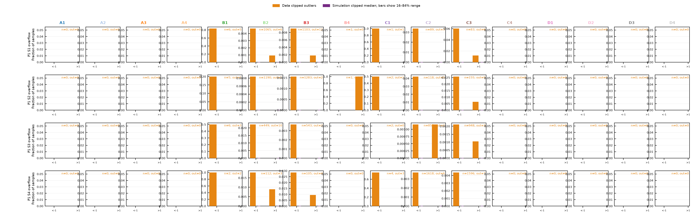

For this selected TT12 comparison, the overflow sheet shows 195 of 22,383 data strip-samples outside ±1 ns across the represented regions and strips, while the four selected simulation files have no such overflow. Counts are per strip-sample (the same event can contribute multiple strips), and the plotted region fractions use each region/strip's own finite sample count.

## TT12 is not explained by its pooled angle plots

The earlier TT12 tertile figures already show that the data and simulation do not track each other consistently once position is resolved. The updated 4 × 4 square plots make the selection explicit in both reconstructed X and Y and extend to ±330 mm, well outside the detector planes. The outer cells now isolate events beyond the ±150 mm plane half-width in X and ±178.5 mm in Y. The mismatch remains position dependent; detached and TimTrack agree with each other, so it is not isolated to one fit method.

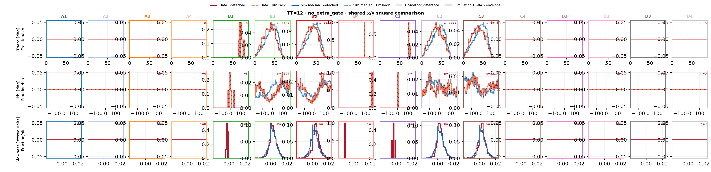

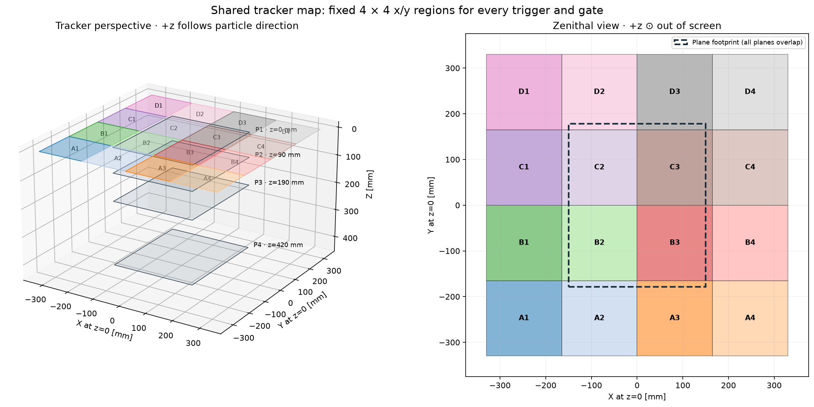

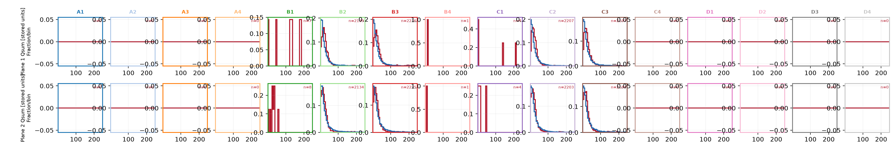

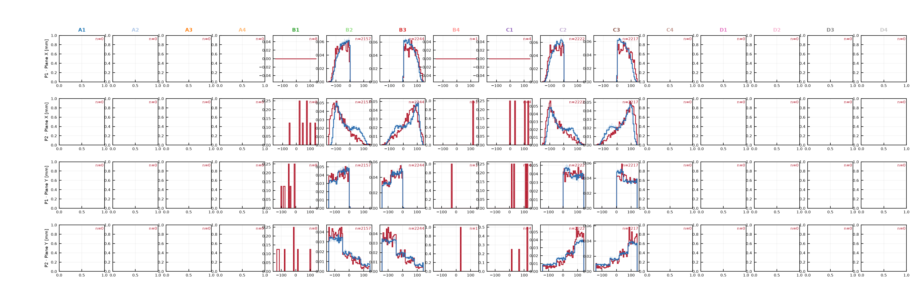

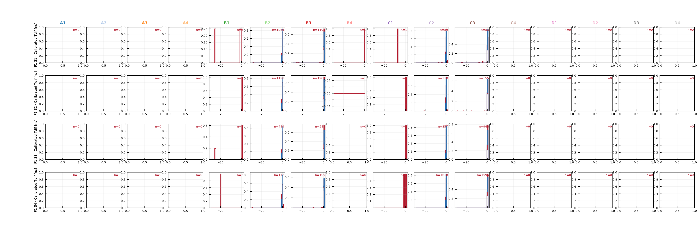

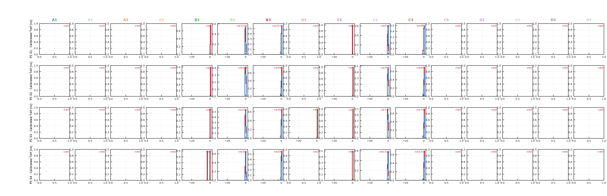

The median data-to-simulation Jensen–Shannon distances for TT12 are 0.147 (theta) and 0.086 (phi) when pooled, rising to 0.156 and 0.144 across the sixteen squares. With the Task-1 cluster-size-1 gate, pooled theta/phi distances are 0.153/0.096 and the square medians are 0.164/0.167. The wider grid shows that this comparison includes peripheral regions outside the physical plane footprint; the per-cell counts in `123_angle_position_cut_shape_metrics.csv` should be checked when interpreting sparse cells.

TT12 is a clear problem, but it is not the only one: the no-extra-gate TT13 control, which has no plane 2, has still larger median distances across the extended squares (0.337 theta and 0.526 phi). TT23 gives 0.202 theta and 0.222 phi across squares; TT234 gives 0.251 theta and 0.291 phi. The 16-cell view includes low-statistics peripheral regions, so these medians are diagnostic summaries, not standalone conclusions. The pattern still means a plane-2-specific explanation is insufficient; compare upstream strip/plane quantities and event counts within these same x/y regions before interpreting the angular differences as physics.

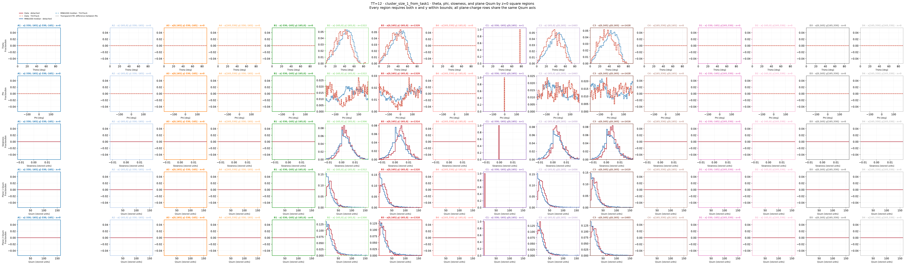

Both plane-Qsum rows are directly below theta, phi, and slowness; the Qsum rows share x-axis range and binning. The same colored columns use the same x/y square cuts throughout, so charge shapes can be compared against the angle shapes in one figure.

## TT12 angle-versus-charge samples and density contours

The separate TT12 family is under `PLOTS/TASK_4/ANGLE_VS_PLANE_QSUM/`. Each of its sixteen region figures overlays faint individual-event points with normalized data and simulation density contours for theta/Qsum and phi/Qsum on planes 1 and 2. This keeps the detailed joint-density comparison while making the underlying point populations visible. The panel titles include sample sizes and Spearman correlations; `126_TT12_angle_qsum_region_correlations.csv` records per-file values.

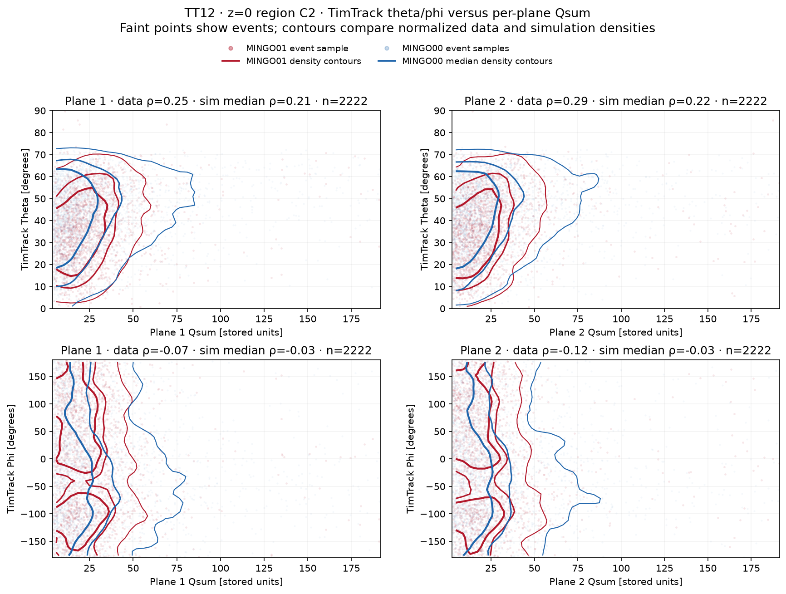

## MINGO02 comparison is active

The shared comparison runner now has an independent MINGO02 profile at `TASK_BY_TASK_COMPARISON/comparison_config_mingo02.json`. It uses MINGO02 data and selects MINGO00 simulations with the matching plane layout z = [0, 145, 290, 435] mm. The first run uses the newest locally available raw file, `mi0226309011801`, processed through Tasks 0–5 so the task-by-task outputs and PDF use the same event sample. The focused profile now runs only TT12 and TT123, and adds raw per-strip Qf/Qb and fitted XP/YP alongside plane X/Y and calibrated per-strip Tdif. All configured upstream-variable panels use events with finite fitted X, Y, theta, and phi. Its report is `PLOTS/MINGO02/TASK_4/ANGLE_POSITION/130_angle_position_by_gate_and_trigger.pdf`; all MINGO02 comparison plots, metrics, and `LAST/` snapshots live under `PLOTS/MINGO02/`, separate from MINGO01.

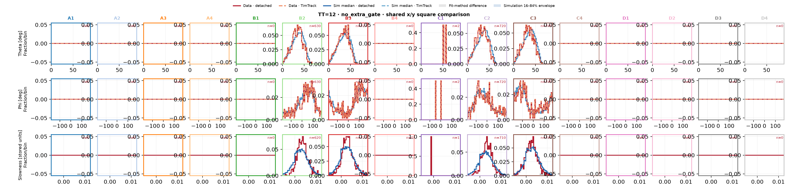

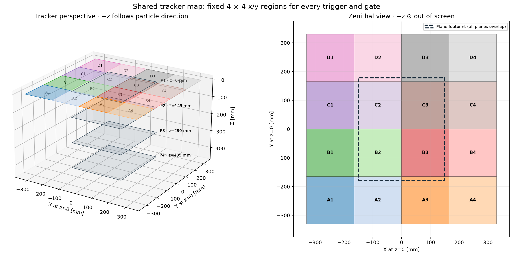

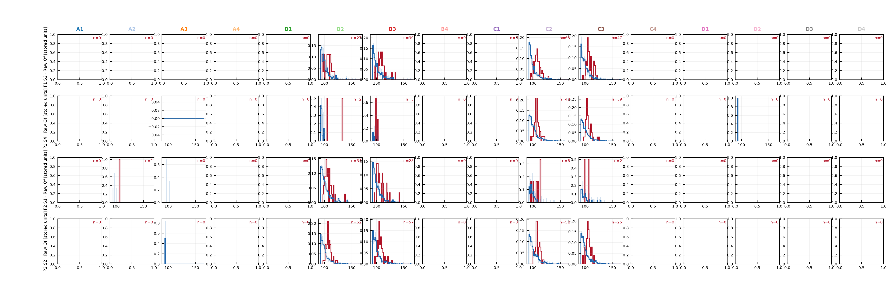

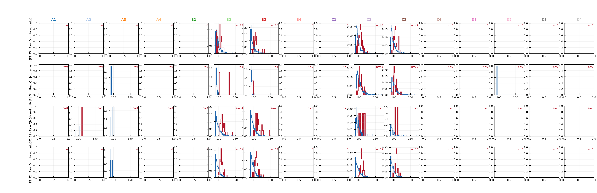

The four selected simulations have the exact configured geometry. Their robust-efficiency distances from this MINGO02 file are 0.69–0.83, so the geometry match is exact but the current simulation envelope is not close in per-plane efficiency. The selection table is `PLOTS/MINGO02/selected_efficiency_matched_simulations.csv`; inspect those distances and the regional event counts before interpreting shape differences. To rerun, use `compare_task_outputs.py --config comparison_config_mingo02.json` from the repository root.

## TT234 theta/phi agreement across reconstructed z=0 positions

The pooled TT234 comparison remains close, while the extended 4 × 4 view now separates the detector footprint from peripheral reconstructed positions. Each 165 mm square applies an X cut and a Y cut together, and the outer cells reach to ±330 mm. Detached and TimTrack are shown together; slowness is added as a third row. The single shared perspective-plus-zenithal tracker map is shown above; all trigger and gate panels use its fixed region boundaries. Some peripheral squares have low event counts, so use the event counts in `123_angle_position_cut_shape_metrics.csv` alongside their shapes.

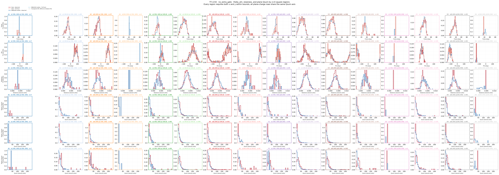

Median uncut data-to-simulation Jensen–Shannon distances are 0.127/0.124 for detached/TimTrack theta and 0.121/0.120 for phi. Across the 16 squares the medians are 0.245/0.258 for theta and 0.294/0.288 for phi, respectively. The wider position range reveals residual differences that the pooled plot hides; sparse outer squares should be interpreted with their event counts.

The TT23 cluster-size-1 position study remains useful, but its extended grid also reaches outside the physical planes. The pooled theta/phi distances are 0.087/0.112, while the medians across 16 squares are 0.227/0.256. This checks agreement under a specific strip topology and within matched reconstructed-position regions; inspect per-cell counts, especially in peripheral squares, alongside the normalized shapes.

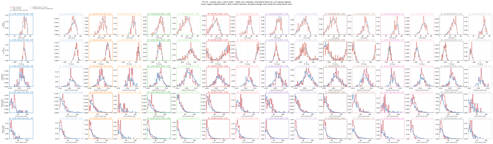

