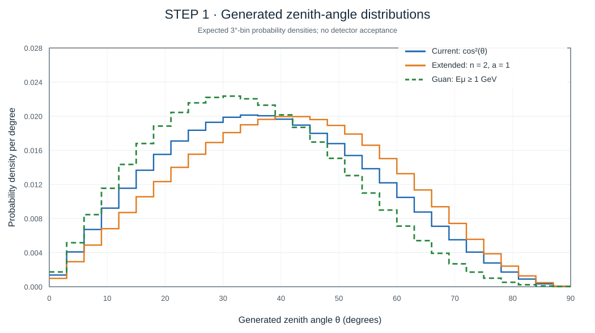
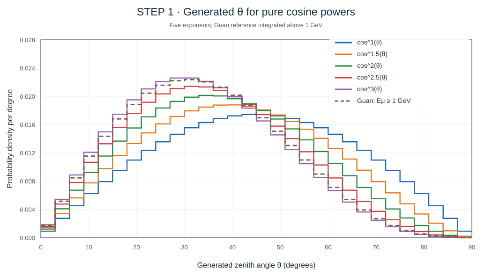
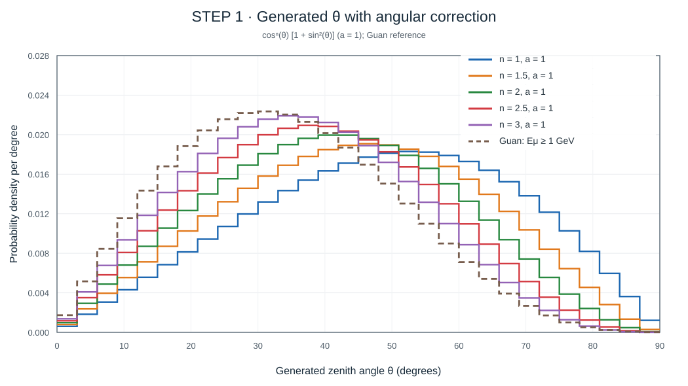

# 2026-11-11 — Generated cosmic-muon zenith angles in the digital twin

## Scope

Follow-up to the 2026-11-10 exploration of the MINGO digital twin's angular generator. This is a **STEP 1 generator-level sensitivity study**, not a comparison of reconstructed angular distributions and not a measurement of atmospheric muon flux. No production simulation, detector data, or station outputs were modified.

The objective is to compare the existing cosine-power distribution with an illustrative one-parameter extension and a zenith-angle shape derived from the sea-level parameterization by Guan et al. The figures are frozen snapshots in this month's FIGURES directory, following the notebook convention.

## Existing implementation

The source is **PIPELINE/MINGO_DIGITAL_TWIN/MASTER_STEPS/STEP_1/step_1_blank_to_generated.py**. Both the in-memory and batch generators calculate

~~~python
exponent = 1.0 / (cos_n + 1.0)
theta = np.arccos(U ** exponent)  # U uniform in [0, 1]
~~~

Consequently, putting u = cos(theta), the generated density is

\[
p(u)=(n+1)u^n,\qquad 0\le u\le1,
\]

or, with respect to theta,

\[
p(\theta)=(n+1)\sin\theta\cos^n\theta,\qquad 0\le\theta\le\pi/2.
\]

The sine is the solid-angle Jacobian: **the generated histogram in theta is not simply proportional to cos^n(theta)**. Phi is uniform. At the time of this inspection, **MASTER_STEPS/STEP_0/config_step_0_physics.yaml** sets **cos_n: [2]**. STEP 0 includes cos_n in the parameter mesh, while STEP FINAL includes it in the parameter signature.

This code models incident muons through a horizontal generation surface. For an azimuthally symmetric shape g(theta), the normalization used here fixes the total rate through that horizontal surface and samples p(u) proportional to g(arccos(u)). Published intensities must be checked for their area convention before direct comparison; conversion from perpendicular-area intensity to horizontal-plane flux introduces a cos(theta) projection.

## Models and assumptions

All models have the same total generated probability (unity) and are compared **before** plane crossings (STEP 2), angle-dependent avalanches (STEP 3), electronics, triggering, and reconstruction. The total incident event rate is kept separate from the angular shape.

1. **Current generator:** g_0(u) = u^n, with n = 1, 1.5, 2, 2.5, 3. Its inverse-CDF generation is u = U^(1/(n+1)).
2. **Phenomenological extension:** g_1(u) = u^n [1 + a(1-u²)], shown for **a = 1**. It reduces exactly to the current model at a = 0. Its angular-normalization integral is
   \[
   Z_1=\frac{1}{n+1}+\frac{2a}{(n+1)(n+3)}.
   \]
   Nonnegativity over the hemisphere is ensured by a >= -1. The chosen a = 1 is illustrative, **not fitted** and **not a literature-prescribed muon law**.
3. **Guan et al. reference:** integrate the modified Gaisser/Guan differential spectrum for muon energies **E >= 1 GeV**, numerically to 10^5 GeV. The displayed horizontal-plane shape is
   \[
   g_G(u)=u\int_{1\,\mathrm{GeV}}^{10^5\,\mathrm{GeV}}
   I_G(E,\arccos u)\,dE,
   \]
   using
   \[
   I_G(E,\theta)=0.14\left(E+\frac{3.64}{c_*^{1.29}}\right)^{-2.7}
   \left[
   \frac{1}{1+1.1 E c_*/115}+
   \frac{0.054}{1+1.1 E c_*/850}
   \right],
   \]
   \[
   c_*=\sqrt{\frac{u^2+p_1^2+p_2 u^{p_3}+p_4 u^{p_5}}
                       {1+p_1^2+p_2+p_4}},
   \]
   with (p1,p2,p3,p4,p5) = (0.102573, -0.068287, 0.958633, 0.0407253, 0.817285) and all E-like constants in GeV. The Guan differential intensity is **treated here under a perpendicular-area convention**, motivating the extra u factor. This convention must be verified against the quantity used in any future quantitative flux fit. The 1 GeV lower cutoff is a **chosen illustration**, not a measured MINGO energy threshold.

The generator currently does not produce muon energy, so the Guan case samples only the **marginal angular shape**, not the joint p(E,theta) distribution. It must not be interpreted as an energy-dependent detector simulation.

## Figures: generated theta only

These vector figures show **analytically/numerically integrated expected probability in each 3-degree bin divided by bin width**, with no Monte Carlo noise. They reproduce the distributions underlying the previously generated 200,000-event-per-model histograms, not the specific random fluctuations of those samples. All curves use the same bins, axes, and unit-area normalization.

### Three models at n = 2

### Pure cosine-power scan

### Corrected cosine-power scan (a = 1)

## Quantitative comparison

For the cosine models the fractions can be computed analytically from integrals over u. Values below are model expectations, not fitted data. Mean angles are numerically integrated.

| Exponent n | Pure: theta > 45° | Extended (a=1): theta > 45° | Pure mean theta | Extended mean theta |
|---:|---:|---:|---:|---:|
| 1.0 | 50.00% | 58.33% | 45.00° | 48.75° |
| 1.5 | 42.04% | 50.13% | 41.19° | 44.71° |
| 2.0 | 35.36% | 42.93% | 38.20° | 41.47° |
| 2.5 | 29.73% | 36.67% | 35.77° | 38.80° |
| 3.0 | 25.00% | 31.25% | 33.75° | 36.56° |
| Guan (E >= 1 GeV) | 26.32% | — | 34.35° | — |

The trend is clear: increasing n concentrates generated directions toward vertical incidence; setting a=1 increases their relative inclined component. For the stated Guan integration assumptions, the reference is more vertical than the default n=2 generator and close in broad angular shape to a steeper cosine power. Similarity of one tail fraction **does not imply equality of the full distributions**.

## Reproducible calculation

The following minimal script regenerates Monte Carlo histograms from the same probability densities. The archived SVG snapshots above instead use the corresponding expected binned probabilities, so they are independent of the random seed.

~~~python
import numpy as np
import matplotlib.pyplot as plt
from scipy.integrate import cumulative_trapezoid, trapezoid

rng = np.random.default_rng(20261110)
N = 200_000
n_values = (1.0, 1.5, 2.0, 2.5, 3.0)
u = np.linspace(0.0, 1.0, 4001)
bins = np.arange(0, 93, 3)

def sample(shape):
    cdf = np.r_[0, cumulative_trapezoid(shape, u)]
    cdf /= cdf[-1]
    return np.degrees(np.arccos(np.interp(rng.random(N), cdf, u)))

p1, p2, p3, p4, p5 = 0.102573, -0.068287, 0.958633, 0.0407253, 0.817285
cos_star = np.sqrt(
    (u*u + p1*p1 + p2*u**p3 + p4*u**p5) / (1 + p1*p1 + p2 + p4)
)
E = np.geomspace(1, 1e5, 601)
C = cos_star[:, None]
I = (
    0.14 * (E[None, :] + 3.64 / C**1.29)**(-2.7)
    * (1/(1 + 1.1*E[None, :]*C/115)
       + 0.054/(1 + 1.1*E[None, :]*C/850))
)
guan = sample(u * trapezoid(I, E, axis=1))

for extended, suffix in ((False, "pure"), (True, "extended_a1")):
    fig, ax = plt.subplots(figsize=(10, 6))
    for n in n_values:
        shape = u**n * (2-u*u if extended else 1)
        angles = sample(shape)
        ax.hist(angles, bins=bins, density=True, histtype="step",
                linewidth=1.7, label=f"n={n:g}")
    ax.hist(guan, bins=bins, density=True, histtype="step",
            linestyle="--", linewidth=2, label="Guan E>=1 GeV")
    ax.set(xlim=(0, 90), xlabel="Generated zenith angle (degrees)",
           ylabel="Probability density (per degree)")
    ax.legend()
    fig.tight_layout()
    fig.savefig(f"generated_theta_{suffix}.png", dpi=180)
    plt.close(fig)
~~~

Requires NumPy, SciPy, and Matplotlib. The calculation uses a fixed RNG seed, while the order of sampling influences the exact Monte Carlo fluctuations.

## Interpretation and limitations

- This is an input-flux sensitivity exercise only. No angular-efficiency correction or production simulation change is justified by these plots alone.
- The finite RPC stack strongly suppresses inclined tracks in the four-plane sample. The STEP 2 active area, plane spacing, azimuthal acceptance, and source-plane extent must be included before comparing with reconstructed real data.
- The STEP 3 model contains an explicit 1/abs(cos(theta)) path-length factor in avalanche generation; changing the incident angular law can change reconstructed plane efficiencies and trigger-type fractions.
- A detector-folded comparison should separately track generated, geometrically crossing, triggered, and reconstructed distributions; use the same selection and exposure definitions for real and simulated samples.
- Energy threshold, overburden, altitude, and atmospheric conditions may affect the physically appropriate angular spectrum. The Guan curve is a reference under stated assumptions, not a calibrated MINGO prediction.
- If a new angular parameter a is implemented, include the model identity and a in STEP 0 parameter meshes, STEP FINAL hashing/metadata, plots, and STEP 1 validation; the existing mean-cos(theta) test currently assumes the pure power law.

## Literature

- Guan, M. et al. (2015), *A parametrization of the cosmic-ray muon flux at sea-level*: https://arxiv.org/abs/1509.06176
- Tang, A. et al. (2006), *Muon simulations for Super-Kamiokande, KamLAND, and CHOOZ*, Physical Review D 74, 053007: https://doi.org/10.1103/PhysRevD.74.053007
- Reyna, D. (2006), *A Simple Parameterization of the Cosmic-Ray Muon Momentum Spectra at the Surface as a Function of Zenith Angle*: https://arxiv.org/abs/hep-ph/0604145
- Su, N. et al. (2021), *A Comparison of Muon Flux Models at Sea Level for Muon Imaging and Low Background Experiments*, Frontiers in Energy Research 9, 750159: https://doi.org/10.3389/fenrg.2021.750159

## Status

Exploratory note. No code, physics parameters, production jobs, or detector datasets changed; only these documentation snapshots and notebook navigation are proposed for the branch.
